# LankaID: Identity Issuing Web Service Application

> **National Digital Identity & Citizen Document Lifecycle Management Platform**  
> Developed for **SE2030 – Software Engineering**, Year 2 Semester 1  
> **Faculty of Computing, Sri Lanka Institute of Information Technology (SLIIT)**

[](https://openjdk.org/)
[](https://spring.io/projects/spring-boot)
[](https://www.microsoft.com/en-us/sql-server)
[](https://maven.apache.org/)
[](#9-system-architecture)
[](#33-testing)
[](#39-limitations)

## Explore LankaID

**[System workflow](#system-workflow)** · **[Member assignments](#member-assignments)** · **[Architecture](#9-system-architecture)** · **[Run locally](#44-quick-start)** · **[Demo checklist](#demo-checklist)**

LankaID brings NIC and passport applications, officer review, appointment booking, and document handover into one citizen service portal. This is an academic prototype: payments, biometric hardware capture, and document production are simulated.

| I want to… | Go to… |
| :--- | :--- |
| Understand the complete citizen journey | [Workflow and decision paths](#system-workflow) |
| See who owns each major function | [Assignment map below](#member-assignments) and [member details](#37-team-members--contributions) |
| Understand how the application is built | [Layered MVC architecture](#9-system-architecture) and [database diagram](#15-database) |
| Try the project on my machine | [Quick start](#44-quick-start) and [configuration](#28-environment-variables) |
| Present the project to an evaluator | [Guided demo checklist](#demo-checklist) |

Expand the **▶ details** sections to explore member responsibilities, workflow messages, and the full reference index. Mermaid diagrams render in GitHub's README view; open the rendered preview to see them as diagrams.

<a id="member-assignments"></a>

## Major functions and assigned members

The assignments below follow the team's existing contribution record in this README. Supporting modules such as OTP, payments, notifications, and administration connect these major functions.

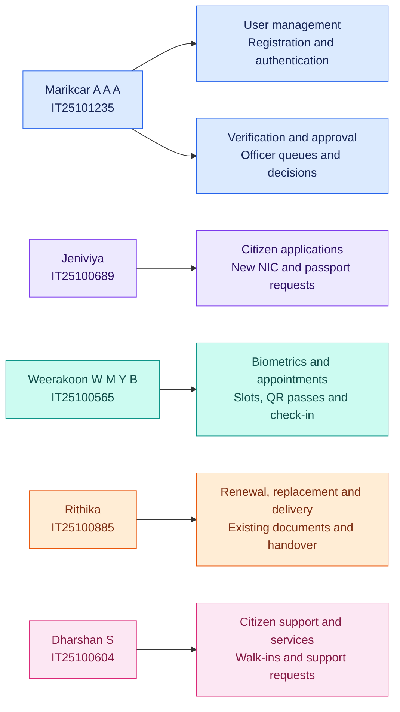

| Member | Assigned major function | Explore responsibility |
| :--- | :--- | :--- |
| **Marikcar A A A** · `IT25101235` | User management; verification and approval | [Account access, officer decisions, OTP and payments](#member-marikcar) |
| **Jeniviya** · `IT25100689` | Citizen application management | [First-time applications, drafts and uploads](#member-jeniviya) |
| **Weerakoon W M Y B** · `IT25100565` | Biometric and appointment management | [Schedules, QR check-in and booking changes](#member-weerakoon) |
| **Rithika** · `IT25100885` | Document renewal, replacement and delivery | [Renewals, replacements and document handover](#member-rithika) |
| **Dharshan S** · `IT25100604` | Citizen support and service management | [Walk-in assistance and support requests](#member-dharshan) |

> These are development assignments. Citizen, NIC officer, passport officer, CSR, director, and administrator are the system's user roles.

[View the full system workflow ↓](#system-workflow)

---

## Table of Contents

<details>
<summary><strong>Expand the complete documentation index</strong></summary>

- [1. Project Title](#1-project-title)
- [2. Project Overview](#2-project-overview)
- [3. Problem Statement](#3-problem-statement)
- [4. Project Objectives](#4-project-objectives)
- [5. Target Users / Stakeholders](#5-target-users--stakeholders)
- [6. System Features](#6-system-features)
- [7. Feature Matrix](#7-feature-matrix)
- [8. System Workflow](#8-system-workflow)
- [9. System Architecture](#9-system-architecture)
- [10. Technology Stack](#10-technology-stack)
- [11. Why These Technologies Were Used](#11-why-these-technologies-were-used)
- [12. Project Structure](#12-project-structure)
- [13. Frontend](#13-frontend)
- [14. Backend](#14-backend)
- [15. Database](#15-database)
- [16. API Documentation](#16-api-documentation)
- [17. Authentication & Authorization](#17-authentication--authorization)
- [18. Validation & Error Handling](#18-validation--error-handling)
- [19. CRUD Operations](#19-crud-operations)
- [20. Major Business Flows](#20-major-business-flows)
- [21. Design Patterns](#21-design-patterns)
- [22. UML / Design Documentation](#22-uml--design-documentation)
- [23. Non-Functional Requirements](#23-non-functional-requirements)
- [24. Ethical and Privacy Considerations](#24-ethical-and-privacy-considerations)
- [25. Setup and Installation](#25-setup-and-installation)
- [26. Cloning the Project](#26-cloning-the-project)
- [27. Database Setup](#27-database-setup)
- [28. Environment Variables](#28-environment-variables)
- [29. Backend Setup](#29-backend-setup)
- [30. Frontend Setup](#30-frontend-setup)
- [31. Running the Complete System](#31-running-the-complete-system)
- [32. How to Use the System](#32-how-to-use-the-system)
- [33. Testing](#33-testing)
- [34. Troubleshooting](#34-troubleshooting)
- [35. Common Commands](#35-common-commands)
- [36. Project Development Process](#36-project-development-process)
- [37. Team Members & Contributions](#37-team-members--contributions)
- [38. Project Requirements Traceability](#38-project-requirements-traceability)
- [39. Limitations](#39-limitations)
- [40. Future Enhancements](#40-future-enhancements)
- [41. Project Status](#41-project-status)
- [42. Screenshots / Visual Guide](#42-screenshots--visual-guide)
- [43. Visual Diagram Collection](#43-visual-diagram-collection)
- [44. Quick Start](#44-quick-start)
- [45. API Quick Reference](#45-api-quick-reference)
- [46. Glossary](#46-glossary)
- [47. References](#47-references)
- [48. License](#48-license)
- [49. Contributing](#49-contributing)
- [50. Final Project Map](#50-final-project-map)

</details>

---

# 1. PROJECT TITLE

# LankaID: Identity Issuing Web Service Application

**LankaID** is an enterprise-grade, full-stack digital identity issuance and lifecycle governance platform engineered to modernize, streamline, and secure the issuance of National Identity Cards (NIC) and Passports in Sri Lanka. Developed as an academic software engineering initiative for **SE2030 (Software Engineering)** at **SLIIT**, LankaID eliminates paper-bound departmental bottlenecks by integrating citizen self-service onboarding, two-factor OTP verification (Email SMTP & SMS Gateway), pre-validation against official state records, tiered officer verification queues, biometric appointment slot publishing with QR check-in, secure payment processing, production batch registry export, and citizen support helpdesk services into a unified, accessible web portal.

---

# 2. PROJECT OVERVIEW

LankaID is an integrated e-Government web service that digitalizes national identity management. In traditional manual governance, citizens endure multiple in-person visits to divisional secretariats or immigration departments, long physical queues, handwritten paper applications prone to loss or errors, and fragmented manual record tracking. 

LankaID solves this problem by providing a cohesive digital ecosystem connecting citizens, regional service centres, verifying officers, customer support personnel, and executive directors.

### Core Capabilities:
- **Citizen Empowerment:** Sri Lankan citizens can register with email OTP verification, link existing identity documentation via SMS OTP validation against legacy state records (`GovernmentIdentityRecord`), draft and submit first-time, renewal, and lost-replacement applications for NICs and Passports, upload supporting PDF/image proofs, pay statutory fees, schedule biometric collection appointments, and track lifecycle status in real time.
- **Officer Verification & Decision Queues:** Role-segregated workbenches allow authorized NIC and Passport officers to inspect citizen data, cross-check submitted document scans, approve applications, reject non-compliant submissions, or demand specific corrections with custom feedback.
- **Biometric Appointment Management:** Service centres publish appointment schedules with controlled daily capacities. Approved citizens choose time slots and receive scannable QR passes. Officers scan passes via integrated browser webcams (`jsQR`) or manual reference input to conduct check-in and record biometric captures.
- **Walk-in Support Services:** Unregistered or walk-in citizens can book physical consultation appointments authenticated via instantaneous phone SMS OTP, allowing Customer Service Representatives (CSRs) to guide offline visitors smoothly.
- **Director Printing & Batch Export:** The Identity Service Director monitors operational analytics across centres and exports batches of biometric-verified applications into standardized CSV registers for physical card embossing and passport personalization.
- **System Administration:** Dedicated administrator controls govern officer onboarding, role assignments, account deactivation, and service centre provisioning.

---

# 3. PROBLEM STATEMENT

```text
┌────────────────────────────────────────────────────────┐
│                        Problem                         │
│  Manual, paper-bound identity issuance processes       │
│  scattered across disjointed departmental counters     │
└───────────────────────────┬────────────────────────────┘
                            │
                            ▼
┌────────────────────────────────────────────────────────┐
│                  Current Difficulties                  │
│  - Long waiting times & overcrowded regional offices   │
│  - Physical document loss, manual filing & paper decay │
│  - Identity fraud, counterfeit claims & lost records   │
│  - Opaque status tracking with no citizen visibility   │
│  - Disconnected appointment bookings & walk-in surges  │
└───────────────────────────┬────────────────────────────┘
                            │
                            ▼
┌────────────────────────────────────────────────────────┐
│                   Proposed Solution                    │
│  LankaID Integrated Web Service Platform               │
│  - Self-service online forms with draft preservation   │
│  - Digital document uploads & verification workbenches │
│  - Dual-channel OTP verification (Email & SMS)         │
│  - Managed biometric appointment slots & QR check-in   │
│  - Automated notifications & real-time parcel tracking │
└───────────────────────────┬────────────────────────────┘
                            │
                            ▼
┌────────────────────────────────────────────────────────┐
│                   Expected Benefits                    │
│  - 80% reduction in in-person office visits            │
│  - Transparent, auditable application lifecycle logs   │
│  - Zero paper document loss through persistent storage │
│  - Tamper-proof scheduling & capacity-capped centres   │
│  - Streamlined national printing batch exports         │
└────────────────────────────────────────────────────────┘
```

Historically, obtaining or renewing an official identity document in Sri Lanka requires citizens to travel physically to government secretariats, submit physical photocopies of birth certificates and police reports, and wait weeks without status visibility. Departmental officers manually verify physical ledgers, creating vulnerabilities to forgery, lost dossiers, and human clerical errors. LankaID transitions this entire workflow to a high-availability digital pipeline, ensuring that physical visits are restricted exclusively to mandatory biometric capture (fingerprints, facial photograph, and signature) at scheduled intervals.

---

# 4. PROJECT OBJECTIVES

| Objective | Description | How the System Addresses It | Implementation Status |
| :--- | :--- | :--- | :--- |
| **Digitize Application Submissions** | Enable online application forms for initial issue, renewal, and lost replacement of NICs and Passports. | Provides dedicated multi-step Thymeleaf form wizards with client-side validation, server-side `@Valid` checks, draft save capabilities, and multipart document uploads. | ✅ Implemented |
| **Identity Linkage & Pre-Validation** | Validate applicant eligibility against pre-existing national demographic records. | Implemented `GovernmentIdentityRecord` querying with SMS OTP verification to link legacy NIC/Passport records before allowing renewals or replacements. | ✅ Implemented |
| **Role-Based Verification Queues** | Provide segregated queues for NIC Officers and Passport Officers to audit documents and issue decisions. | Segregated routing (`/officer/nic/*`, `/officer/passport/*`) with review queues, document previewing, approve, reject, and correction-request workflows. | ✅ Implemented |
| **Structured Biometric Scheduling** | Prevent overcrowding at government centres through managed appointment calendars. | Officers publish calendar slots with specific capacities (`BiometricAppointmentSlot`); citizens book 30-minute intervals within a 14-day window. | ✅ Implemented |
| **Contactless Check-In & Biometrics** | Streamline physical arrivals and track biometric collection. | ZXing generates dynamic QR passes; officers scan passes using HTML5 webcams via `jsQR` to log check-in and record biometric captures. | ✅ Implemented |
| **Rescheduling & Cancellation Governance** | Enforce fair usage policies for changing appointments. | Implemented `BookingChangePolicy` enforcing a strict 72-hour cutoff for free biometric rescheduling, concurrency versioning, and cancellation audit. | ✅ Implemented |
| **Digital Payment & Handover Options** | Support processing fees and flexible delivery channels. | Simulated card payment gateway with Luhn validation, home courier delivery tracking, or physical centre collection handover tracking. | ✅ Implemented |
| **Public Walk-In Support** | Assist citizens who lack computer literacy or digital accounts. | Public portal allowing guest booking verified via live phone SMS OTP, CSR walk-in counter management, and queue assignment. | ✅ Implemented |
| **Centralized Administration & Analytics** | Provide executive oversight and staff account lifecycle management. | Director dashboard with application statistics and printing CSV batch register export; Admin portal for officer CRUD and centre management. | ✅ Implemented |

---

# 5. TARGET USERS / STAKEHOLDERS

| Stakeholder / User | Role | Main Responsibilities | Main System Interactions |
| :--- | :--- | :--- | :--- |
| **Citizen (Applicant)** | Primary End-User | Submits identity applications, uploads supporting documents, verifies identity, pays statutory fees, and attends biometric appointments. | Registers via Email OTP, manages profile, creates NIC/Passport drafts, books biometric appointments, tracks delivery, and files support inquiries. |
| **NIC Verification Officer** | Operational Officer | Audits first-time, renewal, and replacement NIC applications, verifies uploaded certificates, and conducts in-person biometric capture. | Accesses `/officer/nic/applications`, reviews document files, issues approval/rejection/correction decisions, scans check-in QRs, and submits biometric captures. |
| **Passport Verification Officer** | Operational Officer | Audits standard and express travel document applications, verifies proof of citizenship, and performs passport biometric capture. | Accesses `/officer/passport/applications`, inspects birth certificates and parent NIC data, records decisions, and captures biometrics. |
| **Citizen Service Representative (CSR)** | Frontline Support | Manages in-person walk-ins, resolves public complaints, handles identity link requests, and executes physical document handovers. | Accesses `/officer/csr/*`, publishes walk-in slots, checks in walk-in visitors, responds to support inquiries, approves manual identity linking, and logs handovers. |
| **Identity Service Director** | Executive Supervisor | Monitors national throughput, reviews operational metrics, oversees service centres, and generates production printing registers. | Accesses `/officer/director/*`, analyzes daily statistics across centres, selects approved/biometric-complete applications, and exports CSV batches. |
| **System Administrator** | Technical Governance | Manages staff credentials, activates/deactivates personnel accounts, configures regional centres, and broadcasts system notifications. | Accesses `/officer/admin/*`, provisions officers, modifies roles, updates centre capacities, and tracks registered citizen volumes. |
| **Walk-In Visitor (Guest)** | Public User | Books assisted in-person help without registering a full citizen account. | Accesses `/walk-in`, verifies phone number via SMS OTP, books an available CSR slot, and receives a digital appointment token pass. |

---

# 6. SYSTEM FEATURES

```text
LankaID Identity Issuing Web Service Application
│
├── 1. User & Account Management (User_Mgmt)
│   ├── Citizen Account Registration with Gmail SMTP 6-Digit Verification Code
│   ├── Multi-Role Authentication (Citizen, NIC Officer, Passport Officer, CSR, Director, System Admin)
│   ├── Password Security Policies (BCrypt Hashing & Real-time Rule Validation)
│   └── Session Identity Advice & Access State Management
│
├── 2. Citizen Application Management (Citizen_Application_Mgmt)
│   ├── Pre-Validation Eligibility Engine (Checks GovernmentIdentityRecord)
│   ├── New National Identity Card (NIC) Multi-Step Application Form
│   ├── New Passport Application Form (Standard / Express Service Levels)
│   ├── Draft Auto-Save, Draft Editing, and Discard Draft Workflows
│   ├── Supporting Document Multipart Uploader (Birth Certs, Police Reports)
│   ├── Identity Linking Workflow (SMS OTP & CSR Verification for Existing Records)
│   └── Comprehensive Application Status Tracking Timeline
│
├── 3. Document Renewal, Replacement & Delivery (Document_Renewal_Replacement_And_Delivery_Mgmt)
│   ├── NIC Renewal & Lost Replacement Application Workflows
│   ├── Passport Renewal & Lost Replacement Workflows
│   ├── Courier Home-Delivery Address Tracking & Citizen Delivery Confirmation
│   └── Regional Centre Physical Collection Handover Management (CSR Workbench)
│
├── 4. Biometric & Appointment Management (Biometric_And_Appointment_Mgmt)
│   ├── Officer Slot Publishing Engine (BiometricAppointmentSlot)
│   ├── Citizen Calendar Slot Booking Engine (30-Minute Windows, 14-Day Limit)
│   ├── ZXing QR Code Pass Generation & Base64 PNG Download
│   ├── Client-Side Webcam Scanner via jsQR & Manual Reference Fallback
│   ├── Biometric Collection Simulation (Fingerprint, Photograph, Signature)
│   └── Booking Change Governance (72-Hour Cutoff, Version Locking, Rebooking)
│
├── 5. Citizen Support & Walk-In Management (Citizen_Support_And_Service_Mgmt)
│   ├── Public Guest Walk-In Appointment Booking Engine
│   ├── Real-Time Phone SMS OTP Verification via External Phone Gateway
│   ├── Walk-In Token Pass Generation & Reference Recovery
│   ├── CSR Walk-In Appointment Management & Check-In Workbench
│   ├── Citizen Support Ticket Submission (Complaints & General Inquiries)
│   └── CSR Support Response Desk & Ticket Resolution
│
├── 6. Verification & Approval Management (Verification_And_Approval_Management)
│   ├── Role-Segregated NIC and Passport Pending Verification Queues
│   ├── Document Preview Inspection Workbench
│   ├── Three-Way Decision Processing: Approve, Reject, or Request Correction
│   ├── Correction Form Re-Opening with Document Invalidation Flags
│   └── Officer Review Audit History Logging (ApplicationReview)
│
├── 7. Payment Processing (Payment_Mgmt)
│   ├── Statutory Fee Calculator (NIC: LKR 2,000 | Passport: LKR 10,000 | Delivery: LKR 500)
│   ├── Simulated Card Payment Processing (Luhn Check, Expiry & CVV Validation)
│   ├── Booking Change Fee Processing (AppointmentChangePayment)
│   └── Transaction Reference Generation & Receipt Auditing
│
├── 8. Notification System (Notification_Mgmt)
│   ├── Event-Triggered Notifications (Application Submitted, Decision, Payment, Slots)
│   ├── Citizen In-App Notification Center with Read/Unread Status Management
│   └── System Administrator Universal Broadcast Messaging Composer
│
└── 9. Administrative & Executive Governance (Admin_Mgmt)
    ├── Director Operational Analytics Dashboard
    ├── Official Printing Batch Generator & Standardized CSV Register Exporter
    ├── Officer Account Lifecycle Management (Create, Edit, Deactivate, Delete)
    └── Service Centre Infrastructure Management (Districts, Capacities)
```

---

# 7. FEATURE MATRIX

| Module | Primary User | Create | Read | Update | Delete | Validation | Database Persistence | Status |
| :--- | :--- | :---: | :---: | :---: | :---: | :---: | :---: | :--- |
| **Citizen Registration & Auth** | Citizen | ✅ | ✅ | ❌ | ❌ | ✅ | `UserAccount`, `CitizenAccount` | ✅ Implemented |
| **Officer Authentication** | Staff / Admin | ❌ | ✅ | ❌ | ❌ | ✅ | `UserAccount`, `StaffAccount` | ✅ Implemented |
| **Admin Officer Management** | System Admin | ✅ | ✅ | ✅ | ✅ | ✅ | `UserAccount`, `StaffAccount` | ✅ Implemented |
| **Service Centre Management** | System Admin | ✅ | ✅ | ✅ | ✅ | ✅ | `Centre` | ✅ Implemented |
| **New NIC Application** | Citizen | ✅ | ✅ | ✅ | ✅ | ✅ | `Application`, `NICApplication` | ✅ Implemented |
| **New Passport Application** | Citizen | ✅ | ✅ | ✅ | ✅ | ✅ | `Application`, `PassportApplication` | ✅ Implemented |
| **NIC/Passport Renewals** | Citizen | ✅ | ✅ | ✅ | ❌ | ✅ | `Application`, `NIC/Passport` | ✅ Implemented |
| **Document Uploads** | Citizen | ✅ | ✅ | ❌ | ❌ | ✅ | `ApplicationDocument` | ✅ Implemented |
| **Identity Link (SMS OTP)** | Citizen / CSR | ✅ | ✅ | ✅ | ❌ | ✅ | `GovernmentIdentityRecord` | ✅ Implemented |
| **NIC Application Review** | NIC Officer | ❌ | ✅ | ✅ | ❌ | ✅ | `ApplicationReview`, `Application` | ✅ Implemented |
| **Passport Application Review** | Passport Officer | ❌ | ✅ | ✅ | ❌ | ✅ | `ApplicationReview`, `Application` | ✅ Implemented |
| **Payment Gateway** | Citizen | ✅ | ✅ | ❌ | ❌ | ✅ | `Payment` | ✅ Implemented (Simulated) |
| **Biometric Slot Publishing** | Officer | ✅ | ✅ | ✅ | ❌ | ✅ | `BiometricAppointmentSlot` | ✅ Implemented |
| **Biometric Booking & Pass** | Citizen | ✅ | ✅ | ✅ | ✅ | ✅ | `Appointment` | ✅ Implemented |
| **Biometric Check-In & Capture** | Officer | ✅ | ✅ | ❌ | ❌ | ✅ | `AppointmentCheckIn`, `BiometricCollection` | ✅ Implemented (Simulated Capture) |
| **Walk-In Booking (SMS OTP)**| Guest / CSR | ✅ | ✅ | ✅ | ✅ | ✅ | `Appointment`, `WalkInSlot` | ✅ Implemented |
| **Document Delivery / Handover**| Citizen / CSR | ✅ | ✅ | ✅ | ❌ | ✅ | `DocumentDelivery` | ✅ Implemented |
| **Citizen Support & Tickets** | Citizen / CSR | ✅ | ✅ | ✅ | ✅ | ✅ | `SupportRequest` | ✅ Implemented |
| **Director Analytics & Export**| Director | ✅ | ✅ | ❌ | ❌ | ✅ | CSV File Generation | ✅ Implemented |
| **Notifications** | All Users | ✅ | ✅ | ✅ | ❌ | ✅ | `Notification`, `UserNotification` | ✅ Implemented |

**Legend:**
- ✅ **Implemented:** Fully functional in frontend, backend, validation, and database layers.
- ⚠️ **Partial / Simulated:** Operation exists but relies on simulation (e.g., hardware biometric capture, bank card gateway).
- ❌ **Not implemented:** Operation is not designed or supported for that entity.
- 🔵 **Planned:** Scheduled for upcoming releases.

---

<a id="system-workflow"></a>

# 8. SYSTEM WORKFLOW

## From registration to document handover

Follow the arrows to see who acts at each stage. The correction branch returns to officer review; a rejected application ends that request. Renewal and replacement requests join the same review, payment, appointment, and issuance pipeline as first-time applications.

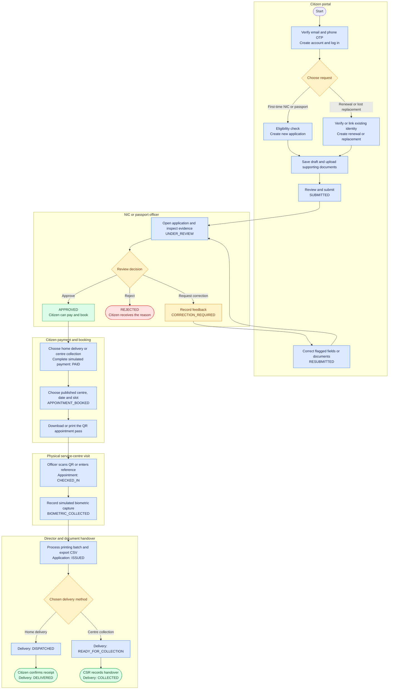

**Text walkthrough:** Register → choose request → save draft and upload → submit → officer review → approve → select delivery and pay → book biometrics → QR check-in → biometric completion → director printing export → delivery or collection. A correction loops back through resubmission; rejection ends that request.

### How member functions connect

| Stage | System actor | Assigned development member | Output passed to the next stage |
| :--- | :--- | :--- | :--- |
| Account creation and access | Citizen | **Marikcar A A A** | Verified citizen account and session |
| First-time application | Citizen | **Jeniviya** | Submitted NIC/passport request and evidence |
| Renewal or replacement | Citizen | **Rithika** | Existing-document request and evidence |
| Verification and decision | NIC/passport officer | **Marikcar A A A** | Approval, correction feedback, or rejection reason |
| Payment support | Citizen | **Marikcar A A A** | Payment record required for biometric booking |
| Appointment and biometrics | Citizen and NIC/passport officer | **Weerakoon W M Y B** | Confirmed appointment, QR pass, and completed biometric record |
| Printing export | Director | Administration module | Issued application and printing CSV |
| Delivery and collection | Citizen and CSR | **Rithika**, with CSR workbench support from **Dharshan S** | Receipt confirmation or recorded handover |
| Help throughout the journey | Guest/citizen and CSR | **Dharshan S** | Walk-in assistance or support response |

### Reading the status labels

Application, payment, appointment, and delivery each have their own status. Payment is recorded as `PAID`; booking moves the application from `APPROVED` to `APPOINTMENT_BOOKED`. Printing sets the application to `ISSUED`; delivery then progresses separately to `DELIVERED` or `COLLECTED`.

<details>
<summary><strong>Explore the application status lifecycle</strong></summary>

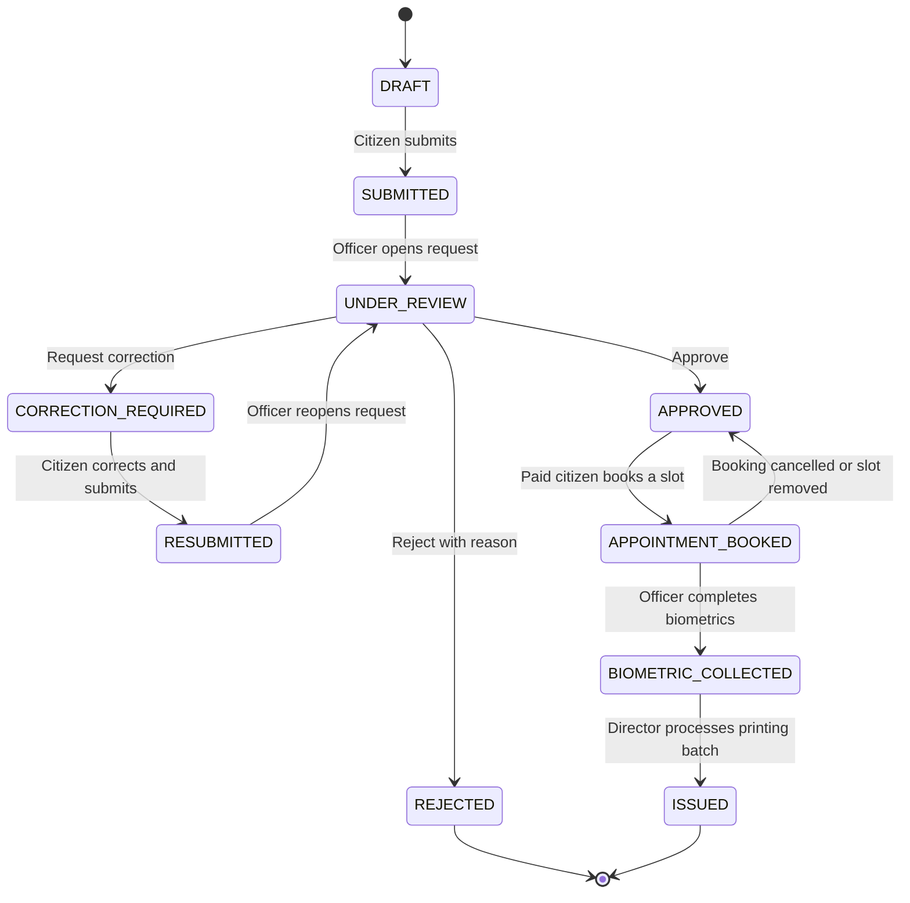

This diagram shows the main implemented application transitions. Delivery completion is tracked on the delivery record after issuance.

</details>

<details>
<summary><strong>Explore the guest walk-in assistance workflow</strong></summary>


Guest assistance is available without a citizen account. A visitor can also recover an appointment through the phone verification flow. Citizens can submit support requests, and CSRs review and respond from their workbench.

</details>

<details>
<summary><strong>Explore the technical system context</strong></summary>

## High-Level System Flow

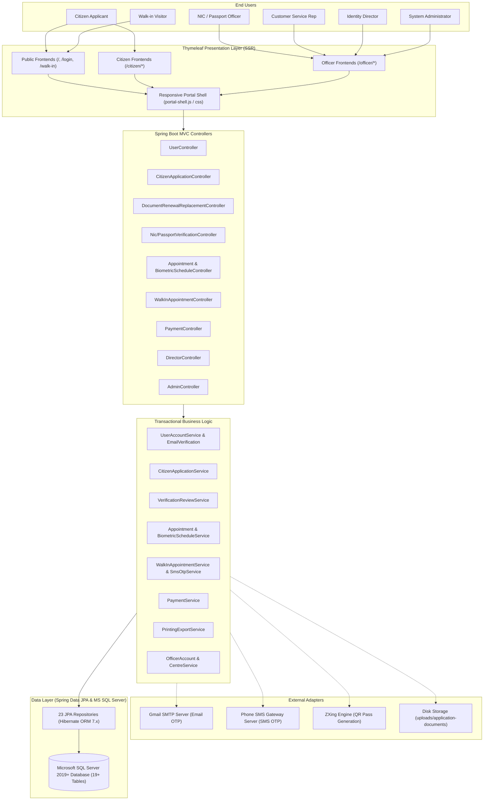

</details>

<details>
<summary><strong>Explore the request sequence between portal, services, and database</strong></summary>

## End-to-End Citizen Application & Issuance Workflow

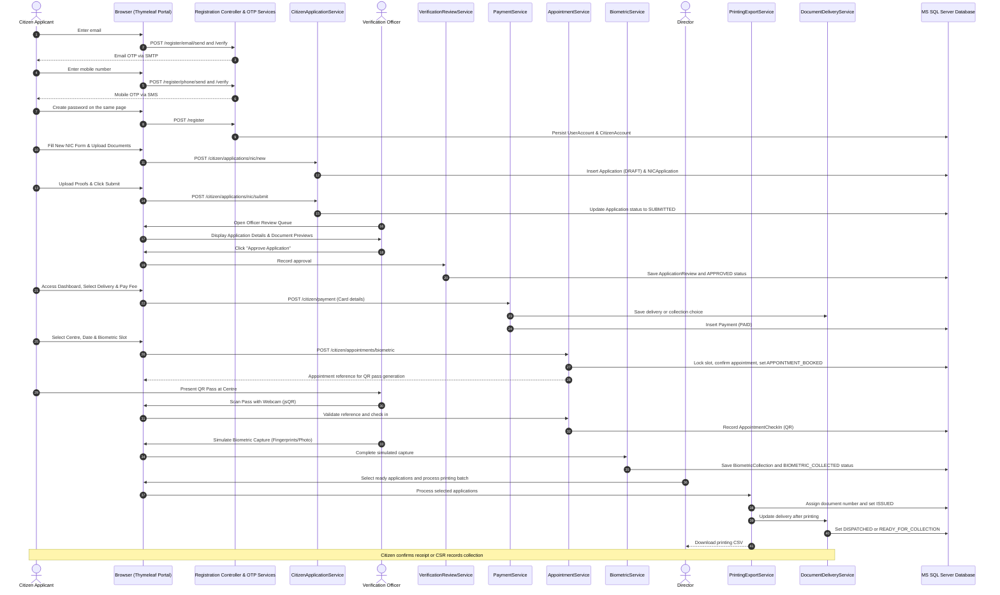

</details>

[Back to visual guide ↑](#explore-lankaid)

---

# 9. SYSTEM ARCHITECTURE

LankaID is architectured as a robust, layered, monolithic web application leveraging Spring Boot's Model-View-Controller (MVC) paradigm combined with Thymeleaf server-side rendering and asynchronous client scripts.

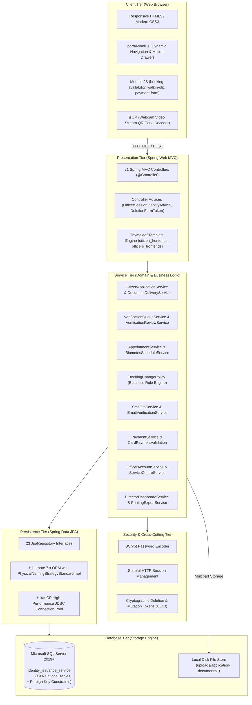

### Architectural Layer Responsibilities:
1. **Client Tier:** Delivers a modern user experience via server-rendered HTML5 pages augmented by client-side event handlers. Dynamic interactive elements (slot availability loaders, phone formatting, card Luhn validators, and video-stream QR decoding) run natively in the browser without heavyweight JavaScript frameworks.
2. **Presentation Tier:** 21 controllers map clean, RESTful URL endpoints to business workflows. Controller Advices intercept requests to inject identity context into models and guard state-modifying requests against double-submission or cross-site request hijacking.
3. **Service Tier:** Pure Spring `@Service` beans encapsulate transactional boundaries (`@Transactional`). Business rules—such as appointment cancellation deadlines (`BookingChangePolicy`), national identity link verifications, and card payment validation—remain isolated from controller and database concerns.
4. **Security Tier:** Enforces password hashing using BCrypt with salt, manages authenticated state across HTTP sessions with explicit role isolation, and validates single-use cryptographically random tokens on critical destructive actions.
5. **Persistence Tier:** 23 Spring Data JPA interfaces provide clean data access abstractions utilizing JPQL and derived query methods, executed through Hibernate ORM with HikariCP connection pooling.
6. **Database Tier:** Microsoft SQL Server 2019+ executes declarative constraints, cascading rules, unique indexes, and relational integrity across 19 physical tables.

---

# 10. TECHNOLOGY STACK

| Layer | Technology | Purpose | Evidence in Repository |
| :--- | :--- | :--- | :--- |
| **Backend Runtime** | Java 17 LTS (Java 25 compatible) | Enterprise execution platform | `pom.xml` (`<java.version>17</java.version>`) |
| **Backend Framework** | Spring Boot 4.1.0 | Microservices and web application framework | `pom.xml` (`spring-boot-starter-parent:4.1.0`) |
| **Web MVC Framework**| Spring Web MVC | Request routing, model binding, and HTTP handling | `pom.xml` (`spring-boot-starter-webmvc`) |
| **View Engine** | Thymeleaf 3.x | Server-Side Rendering (SSR) of dynamic templates | `pom.xml` (`spring-boot-starter-thymeleaf`) |
| **ORM / Data Access**| Spring Data JPA / Hibernate 7.x | Object-Relational Mapping & persistence abstraction | `pom.xml` (`spring-boot-starter-data-jpa`) |
| **Database Engine** | Microsoft SQL Server 2019+ | Relational schema, indexes, and transaction engine | `application.properties`, SQL scripts in `database/` |
| **Database Driver** | Microsoft JDBC Driver for SQL Server (`mssql-jdbc`) | High-performance JDBC connectivity | `pom.xml` (`com.microsoft.sqlserver:mssql-jdbc`) |
| **Connection Pooling**| HikariCP | JDBC Connection pooling | Application logs (`com.zaxxer.hikari.HikariDataSource`) |
| **Validation** | Jakarta Bean Validation / Hibernate Validator | Declarative data validation annotations | `pom.xml` (`spring-boot-starter-validation`) |
| **Security Hashing** | Spring Security Crypto | BCrypt password and secret hashing | `pom.xml` (`spring-security-crypto`) |
| **Email Protocol** | Spring Boot Mail / JavaMail (SMTP) | Outbound registration 6-digit OTP delivery | `pom.xml` (`spring-boot-starter-mail`), `application.properties` |
| **SMS Gateway API** | Custom REST Client / HTTP POST | Outbound phone SMS OTP delivery | `PhoneSmsSender.java`, `application.properties` |
| **QR Code Engine** | ZXing (Zebra Crossing) Core 3.5.4 | Server-side generation of appointment pass QR codes | `pom.xml` (`com.google.zxing:core:3.5.4`) |
| **QR Code Scanner** | WebJars jsQR 1.4.0 | Client-side video stream QR decoding via webcam | `pom.xml` (`org.webjars.npm:jsqr:1.4.0`) |
| **Code Boilerplate** | Project Lombok | Automatic getters, setters, constructors, builders | `pom.xml` (`org.projectlombok:lombok`) |
| **Testing Framework**| JUnit 5 / Spring Test / Mockito | Unit, integration, and mock web testing | `pom.xml`, 38 test suites in `src/test/java` |
| **Build Automation** | Apache Maven | Dependency management and build packaging | `pom.xml`, `mvnw`, `mvnw.cmd` |
| **Styling & Design** | Vanilla CSS3 (Custom Design System) | Modern UI with dark/light themes and glassmorphism | `src/main/resources/static/css/*` |

---

# 11. WHY THESE TECHNOLOGIES WERE USED

### 1. Spring Boot & Java 17 LTS
- **What is it?** An industry-standard, strongly typed backend ecosystem known for performance and stability.
- **Why used?** Provides out-of-the-box support for modular dependency injection, transaction management, multipart file handling, and seamless JPA database integration.
- **Where used?** The entire backend application infrastructure (`lk.sliit.identityissuanceservice.*`).
- **Benefit:** Guarantees strict compile-time type safety, automated configuration, and enterprise-grade maintainability.

### 2. Thymeleaf Template Engine
- **What is it?** A modern XML/XHTML/HTML5 server-side template engine for Java.
- **Why used?** Enables natural templating where HTML files remain fully readable in standard browsers and bind cleanly to Spring MVC models without client-side hydration complexity.
- **Where used?** `src/main/resources/templates/` (`citizen_frontends`, `officers_frontends`).
- **Benefit:** Drastically improves initial page load speed, search engine readability, and eliminates API synchronization drift.

### 3. Microsoft SQL Server & Hibernate JPA
- **What is it?** An enterprise relational database management system coupled with Jakarta Persistence API.
- **Why used?** Identity issuance demands absolute ACID transaction compliance, strict foreign key constraints, unique indexing on national numbers, and relational integrity.
- **Where used?** `identity_issuance_service` database and all 23 repository interfaces.
- **Benefit:** Prevents orphan records, eliminates data corruption, and automates schema validation via Hibernate DDL checks.

### 4. ZXing & jsQR
- **What is it?** ZXing is an open-source Java barcode/QR generator; jsQR is a pure JavaScript QR reader library.
- **Why used?** Needed a reliable, contactless check-in system that bridges digital passes with physical counter desks without requiring expensive specialized hardware scanners.
- **Where used?** `AppointmentPassService.java` (backend generation) and `officer_appointments.html` / `biometric_collection.html` (frontend camera scanning).
- **Benefit:** Citizens display QR codes on mobile devices or paper; officers use standard laptop webcams for instantaneous verification.

### 5. Vanilla CSS3 Design System & Modular JS
- **What is it?** Handcrafted CSS design tokens and modular JavaScript utilities without heavy frontend framework dependencies.
- **Why used?** Avoids heavy build pipelines (Webpack, Vite, npm dependencies) while ensuring sub-millisecond styling performance, unified color tokens, and responsive mobile drawers.
- **Where used?** `portal-shell.css`, `citizen-theme.css`, `officer-dashboard-theme.css`.
- **Benefit:** Zero dependency rot, 100% control over accessibility and CSS layouts, and flawless cross-browser compatibility.

---

# 12. PROJECT STRUCTURE

```text
LankaID/
├── .mvn/wrapper/                         # Maven wrapper binary and properties
├── database/                             # Database migration & schema scripts
│   ├── appointment-change-payments.sql   # Booking change payment table & versioning script
│   └── biometric-appointment-scheduling.sql # Biometric slot publishing table & indexes
├── src/
│   ├── main/
│   │   ├── java/lk/sliit/identityissuanceservice/
│   │   │   ├── IdentityIssuanceServiceApplication.java # Main Spring Boot Entry Point
│   │   │   ├── Admin_Mgmt/               # System Admin & Director Governance Module
│   │   │   │   ├── Controller/           # AdminController, DirectorController
│   │   │   │   ├── Dto/                  # Performance, stats, and registration DTOs
│   │   │   │   ├── Model/                # AdminAccount, StaffAccount
│   │   │   │   ├── Repository/           # AdminAccountRepository, StaffAccountRepository
│   │   │   │   └── Service/              # OfficerAccountService, PrintingExportService, etc.
│   │   │   ├── Biometric_And_Appointment_Mgmt/ # Biometric & Appointment Module
│   │   │   │   ├── Controller/           # AppointmentController, BiometricScheduleController, etc.
│   │   │   │   ├── Dto/                  # AppointmentBookingDetails, BiometricSlotView, etc.
│   │   │   │   ├── Model/                # Appointment, AppointmentCheckIn, BiometricAppointmentSlot, etc.
│   │   │   │   ├── Repository/           # AppointmentRepository, CentreRepository, etc.
│   │   │   │   └── Service/              # AppointmentService, BiometricScheduleService, BookingChangePolicy
│   │   │   ├── Citizen_Application_Mgmt/ # Core Application Submission Module
│   │   │   │   ├── Controller/           # CitizenApplicationController, DraftDocumentController, etc.
│   │   │   │   ├── Dto/                  # NewNicApplicationForm, NewPassportApplicationForm, etc.
│   │   │   │   ├── Model/                # CitizenApplication, NICApplication, PassportApplication, etc.
│   │   │   │   ├── Repository/           # CitizenApplicationRepository, ApplicationDocumentRepository, etc.
│   │   │   │   └── Service/              # CitizenApplicationService, IdentityLinkService
│   │   │   ├── Citizen_Support_And_Service_Mgmt/ # Support & Walk-In Module
│   │   │   │   ├── Controller/           # CitizenSupportController, WalkInAppointmentController, etc.
│   │   │   │   ├── Dto/                  # SupportRequestForm, WalkInAppointmentView, WalkInSlotView, etc.
│   │   │   │   ├── Model/                # SupportRequest, WalkInSlot
│   │   │   │   ├── Repository/           # SupportRequestRepository, WalkInSlotRepository, etc.
│   │   │   │   └── Service/              # CitizenSupportService, WalkInAppointmentService, etc.
│   │   │   ├── Document_Renewal_Replacement_And_Delivery_Mgmt/ # Renewals & Handover Module
│   │   │   │   ├── Controller/           # DocumentRenewalReplacementController, DocumentDeliveryController
│   │   │   │   ├── Dto/                  # NicRenewalReplacementForm, CitizenDeliveryDetails, etc.
│   │   │   │   ├── Model/                # DocumentDelivery
│   │   │   │   ├── Repository/           # DocumentDeliveryRepository
│   │   │   │   └── Service/              # DocumentRenewalReplacementService, DocumentDeliveryService
│   │   │   ├── Notification_Mgmt/        # In-App Notification Module
│   │   │   │   ├── Controller/           # NotificationController
│   │   │   │   ├── Dto/                  # CitizenNotificationDto
│   │   │   │   ├── Model/                # Notification, UserNotification, UserNotificationId
│   │   │   │   ├── Repository/           # NotificationRepository, UserNotificationRepository
│   │   │   │   └── Service/              # NotificationService
│   │   │   ├── OTP_Mgmt/                 # Multi-Channel OTP Module
│   │   │   │   ├── Otp/                  # OtpChallenge, SmsOtpService, SriLankanMobileNumber
│   │   │   │   └── Sms/                  # PhoneSmsSender, SmsRequest, SmsSender
│   │   │   ├── Payment_Mgmt/             # Fee & Card Processing Module
│   │   │   │   ├── Controller/           # PaymentController
│   │   │   │   ├── Dto/                  # CardPaymentForm, PaymentSummary
│   │   │   │   ├── Model/                # Payment, AppointmentChangePayment
│   │   │   │   ├── Repository/           # PaymentRepository, AppointmentChangePaymentRepository
│   │   │   │   └── Service/              # PaymentService, CardPaymentValidation, WalkInPaymentService
│   │   │   ├── User_Mgmt/                # User Accounts & Auth Module
│   │   │   │   ├── Controller/           # UserController, OfficerSessionIdentityAdvice, DeletionFormToken
│   │   │   │   ├── Dto/                  # CitizenRegistrationDto, LoginRequestDto, OfficerLoginRequestDto
│   │   │   │   ├── Model/                # UserAccount, CitizenAccount
│   │   │   │   ├── Repository/           # UserAccountRepository, CitizenAccountRepository
│   │   │   │   └── Service/              # UserAccountService, EmailVerificationService, PasswordRules
│   │   │   └── Verification_And_Approval_Management/ # Officer Auditing Module
│   │   │       ├── Controller/           # NicVerificationController, PassportVerificationController, etc.
│   │   │       ├── Dto/                  # VerificationQueueItem, VerificationReviewDetails, etc.
│   │   │       ├── Model/                # ApplicationReview
│   │   │       ├── Repository/           # ApplicationReviewRepository, VerificationApplicationRepository
│   │   │       └── Service/              # VerificationQueueService, VerificationReviewService
│   │   └── resources/
│   │       ├── application.properties    # Core Spring Boot & Database Configurations
│   │       ├── messages.properties       # Form validation error message definitions
│   │       ├── static/                   # Static UI Web Assets
│   │       │   ├── css/                  # portal-shell.css, citizen-theme.css, officer-dashboard-theme.css
│   │       │   ├── js/                   # portal-shell.js, form-errors.js, walkin-otp.js, walkin-phone.js
│   │       │   └── [Module]/             # Module-specific JS & CSS (booking-availability.js, etc.)
│   │       └── templates/                # Thymeleaf HTML Templates
│   │           ├── index.html            # Public Landing Portal Page
│   │           ├── login_portal.html     # Unified Citizen/Officer Login Page
│   │           ├── citizen_frontends/    # 18 Citizen UI Views (dashboard, forms, passes, payments)
│   │           ├── officers_frontends/   # 16 Officer & Admin Views (queues, reviews, collections)
│   │           └── fragments/            # Shared UI Fragments (booking_change_card.html)
│   └── test/java/lk/sliit/identityissuanceservice/ # 38 Integration & Unit Test Suites
├── uploads/                              # Persistent file storage for uploaded document scans
├── pom.xml                               # Maven Project Object Model configuration
└── README.md                             # Complete Project Documentation
```

---

# 13. FRONTEND

The frontend is constructed using **Server-Side Rendered (SSR) Thymeleaf 3.x HTML5**, integrated with a custom design system styled in Vanilla CSS3 and enriched with targeted client-side JavaScript.

### Key Frontend Capabilities:
- **Unified Portal Shell:** All authenticated pages link to `portal-shell.css` and `portal-shell.js`. This creates a responsive dual-sidebar experience for officers and a streamlined header for citizens, with active-link indicators, user avatars, and mobile hamburger navigation drawers.
- **Dynamic Slot Availability:** `booking-availability.js` asynchronously fetches available dates and published 30-minute capacity counters for the chosen service centre without requiring full-page reloads.
- **Client-Side Validation:** `form-errors.js`, `password-rules.js`, and `payment-form.js` enforce pattern checks (NIC formats, card Luhn checksums, expiry dates) before form submission.
- **Webcam QR Decoding:** Integrated `jsQR` webcam video streaming allows officers to point their laptop/USB cameras at citizen passes to automatically extract booking references.
- **Print Optimization:** Print stylesheets automatically suppress navigation sidebars, headers, and buttons, generating formatted physical appointment passes.

## Frontend Module Table

| Page / Template | Purpose | Target User | Key Controllers / APIs Used |
| :--- | :--- | :--- | :--- |
| `index.html` | Public landing page explaining services and eligibility | General Public | `UserController` (`GET /`) |
| `login_portal.html` | Unified tabbed login portal for Citizens and Staff | All Roles | `UserController` (`POST /login`, `POST /login/officer`) |
| `citizen_register.html` | Inline email OTP, SMS OTP, and password registration flow | Citizen | `CitizenRegistrationController` (`/register/*`) |
| `forgot_password.html` | Email-verified citizen password reset | Citizen | `PasswordResetController` (`/forgot-password/*`) |
| `citizen_dashboard.html` | Primary citizen home view showing status, notifications & actions | Citizen | `CitizenApplicationController` (`GET /citizen/dashboard`) |
| `nic_application_form.html` | Multi-step form for first-time, renewal, or correction NICs | Citizen | `CitizenApplicationController` (`/citizen/applications/nic/*`) |
| `passport_application_form.html`| Form for Standard/Express travel documents | Citizen | `CitizenApplicationController` (`/citizen/applications/passport/*`) |
| `application_document_upload.html`| Multipart file upload screen for mandatory document proofs | Citizen | `CitizenApplicationController` (`POST .../documents`) |
| `citizen_application_review.html`| Summary screen for review prior to final submission | Citizen | `CitizenApplicationController` (`POST .../submit`) |
| `payment_gateway.html` | Card payment and delivery choice form | Citizen | `PaymentController` (`POST /citizen/payment`) |
| `biometric_appointment_booking.html`| Interactive centre and calendar slot selector | Citizen | `AppointmentController` (`POST /citizen/appointments/biometric/book`) |
| `biometric_appointment_pass.html`| QR-coded printable and downloadable appointment pass | Citizen | `AppointmentController` (`GET /citizen/appointments/{ref}/pass`) |
| `booking_change.html` | Rescheduling and cancellation workbench | Citizen / Guest | `BiometricBookingChangeController` (`/citizen/appointments/{ref}/manage`) |
| `walkin_appointment_booking.html` | Guest phone verification & slot booking wizard | Guest Visitor | `WalkInAppointmentController` (`/walk-in/*`) |
| `nic_verification_queue.html` | Pending application audit queue for NIC officers | NIC Officer | `NicVerificationController` (`GET /officer/nic/applications`) |
| `passport_verification_queue.html`| Pending audit queue for Passport officers | Passport Officer| `PassportVerificationController` (`GET /officer/passport/applications`) |
| `application_review.html` | Detailed officer review view with document previews & decisions | Officer | `Nic/PassportVerificationController` (`POST .../approve`, `/reject`, `/correction`) |
| `biometric_schedule.html` | Officer slot publishing calendar | Officer | `BiometricScheduleController` (`POST .../schedule/publish`) |
| `biometric_collection.html` | In-person check-in and biometric capture desk | Officer | `BiometricController` (`POST /officer/{service}/biometrics/collect`) |
| `document_collection.html` | CSR physical document handover desk | CSR | `DocumentDeliveryController` (`POST /officer/csr/deliveries/handover`) |
| `director_dashboard.html` | Operational statistics and charts | Director | `DirectorController` (`GET /officer/director`) |
| `printing_export.html` | Printing batch preparation and CSV register download | Director | `DirectorController` (`POST .../printing/process`, `GET .../download`) |
| `admin_dashboard.html` | Staff management and service centre provisioning | System Admin | `AdminController` (`/officer/admin/*`) |

---

# 14. BACKEND

The backend follows an enterprise layered architecture where HTTP requests flow through strict controller mappings, validation handlers, transactional business services, and JPA repositories.

```text
HTTP Request (Client / Browser)
       │
       ▼
[Front Controller: Spring DispatcherServlet]
       │
       ▼
[Controller Layer (@Controller)]
  - Handles URL parameters & path variables
  - Validates session permissions & form tokens
       │
       ▼
[Validation Layer (Jakarta Bean Validation / Custom Validators)]
  - Evaluates @Valid, @NotBlank, regex patterns
  - Checks business constraints (e.g., BookingChangePolicy)
       │
       ▼
[Service Layer (@Service & @Transactional)]
  - Executes core business rules
  - Orchestrates external adapters (SMTP, SMS, ZXing)
  - Enforces database state transitions
       │
       ▼
[Repository Layer (@Repository / Spring Data JPA)]
  - Abstract CRUD & custom JPQL/derived queries
       │
       ▼
[Persistence Layer (Hibernate ORM 7.x & HikariCP)]
  - Executes parameterized SQL queries
       │
       ▼
[Database (Microsoft SQL Server 2019+)]
       │
       ▼
[Model Return & View Resolution (Thymeleaf)]
```

### Key Java Packages:
- `lk.sliit.identityissuanceservice.User_Mgmt`: Controls user registration, login authentication, password rules, and session lifecycle.
- `lk.sliit.identityissuanceservice.Citizen_Application_Mgmt`: Drives application drafting, pre-validation eligibility, document uploads, and identity linking.
- `lk.sliit.identityissuanceservice.Document_Renewal_Replacement_And_Delivery_Mgmt`: Manages renewal workflows, police report attachments, and courier delivery tracking.
- `lk.sliit.identityissuanceservice.Biometric_And_Appointment_Mgmt`: Manages centre calendars, slot capacity controls, booking change policies, QR pass generation, and biometric collections.
- `lk.sliit.identityissuanceservice.Citizen_Support_And_Service_Mgmt`: Implements phone SMS OTP walk-in booking and citizen support ticket messaging.
- `lk.sliit.identityissuanceservice.Verification_And_Approval_Management`: Manages role-isolated officer queues and multi-action review decisions.
- `lk.sliit.identityissuanceservice.Payment_Mgmt`: Encapsulates statutory fee schedules, card Luhn validations, and payment receipt records.
- `lk.sliit.identityissuanceservice.Notification_Mgmt`: Publishes event-driven citizen notifications and administrator broadcasts.
- `lk.sliit.identityissuanceservice.Admin_Mgmt`: Houses the director dashboard, CSV batch generation, and administrator staff governance.

---

# 15. DATABASE

LankaID connects to **Microsoft SQL Server 2019+** under the database catalog `identity_issuance_service`. The persistence model is defined by 19 primary physical tables plus 2 migration extension tables.

## Entity Relationship (ER) Diagram

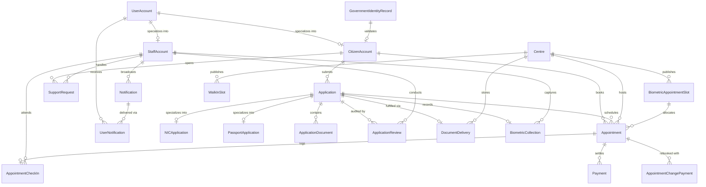

## Relational Schema Specifications

| Table Name | Primary Key | Foreign Keys | Key Attributes & Constraints | Purpose |
| :--- | :--- | :--- | :--- | :--- |
| `UserAccount` | `user_id` (PK, Identity) | None | `email` (UQ), `phone` (UQ), `password_hash`, `account_status`, `email_verified`, `phone_verified` | Core credential & authentication table |
| `CitizenAccount` | `user_id` (PK) | `user_id` -> `UserAccount`, `government_record_id` -> `GovernmentIdentityRecord` | `family_name`, `given_name`, `date_of_birth`, `gender`, `permanent_*`, `postal_*`, `dual_citizen` | Citizen demographic & residential details |
| `StaffAccount` | `user_id` (PK) | `user_id` -> `UserAccount` | `employee_no` (UQ), `staff_role` (CK: NIC_OFFICER, PASSPORT_OFFICER, CSR, DIRECTOR, SYSTEM_ADMIN), `staff_status` | Staff identity, operational roles & permissions |
| `GovernmentIdentityRecord` | `government_record_id` (PK) | None | `nic_no` (UQ), `passport_no` (UQ), `registered_email`, `registered_phone`, `identity_status` | Legacy national registry for pre-validation |
| `Centre` | `centre_id` (PK) | None | `centre_name`, `city`, `district`, `daily_capacity` (1-2000), `centre_status` (ACTIVE/INACTIVE), UQ(`centre_name`, `city`) | Physical government service branches |
| `Application` | `application_id` (PK) | `citizen_id` -> `CitizenAccount` | `application_no` (UQ), `service_type` (NIC/PASSPORT), `application_kind` (NEW/RENEWAL/LOST), `current_status` | Base identity document application record |
| `NICApplication` | `application_id` (PK) | `application_id` -> `Application` | `last_nic_no`, `last_issued_date`, `police_station`, `police_report_date` | Subclass table for NIC-specific details |
| `PassportApplication`| `application_id` (PK) | `application_id` -> `Application` | `service_level`, `travel_document_type`, `nic_proof_no`, `parent_nic_no` | Subclass table for Passport travel specifics |
| `ApplicationDocument` | `document_id` (PK) | `application_id` -> `Application`, `verified_by_staff_id` -> `StaffAccount` | `document_type`, `file_path`, `verification_status`, `uploaded_at` | Metadata for uploaded digital scans |
| `ApplicationReview` | `review_id` (PK) | `application_id` -> `Application`, `staff_id` -> `StaffAccount` | `review_sequence`, `decision`, `correction_message`, `reviewed_at`, UQ(`application_id`, `review_sequence`) | Audit trail of officer verification actions |
| `BiometricAppointmentSlot` | `slot_id` (PK) | `centre_id` -> `Centre` | `service_type`, `slot_date`, `slot_time`, `slot_capacity`, `is_available`, UQ(`centre_id`, `service_type`, `slot_date`, `slot_time`) | Officer-published biometric booking slots |
| `Appointment` | `appointment_id` (PK) | `citizen_id` -> `CitizenAccount`, `application_id` -> `Application`, `centre_id` -> `Centre`, `biometric_slot_id` -> `BiometricAppointmentSlot` | `reference_no` (UQ), `appointment_type` (BIOMETRIC/WALK_IN), `scheduled_at`, `appointment_status`, `qr_code`, `booking_version` | Scheduled biometric and walk-in bookings |
| `AppointmentCheckIn` | `appointment_id` (PK) | `appointment_id` -> `Appointment`, `staff_id` -> `StaffAccount` | `checked_in_at`, `check_in_method` (QR/MANUAL) | Physical attendance audit logging |
| `BiometricCollection` | `application_id` (PK) | `application_id` -> `Application`, `staff_id` -> `StaffAccount` | `collected_at`, `collection_status` | Physical biometric capture audit |
| `Payment` | `payment_id` (PK) | `appointment_id` -> `Appointment` | `transaction_reference` (UQ), `amount`, `paid_at`, `payment_status` | Statutory fee collection receipt |
| `AppointmentChangePayment`| `change_payment_id` (PK)| `appointment_id` -> `Appointment` | `request_token` (UQ), `change_type`, `amount`, `previous_scheduled_at`, `new_scheduled_at`, `paid_at` | Audit of rescheduling payment transactions |
| `WalkInSlot` | `slot_id` (PK) | `centre_id` -> `Centre` | `slot_date`, `slot_time`, `slot_capacity`, `is_available`, UQ(`centre_id`, `slot_date`, `slot_time`) | CSR-published public walk-in capacity |
| `Notification` | `notification_id` (PK)| `sent_by_staff_id` -> `StaffAccount` | `notification_type`, `message`, `is_broadcast`, `created_at` | Broadcast and system-generated messages |
| `UserNotification` | (`notification_id`, `user_id`) (Composite PK) | `notification_id` -> `Notification`, `user_id` -> `UserAccount` | `delivered_at`, `read_at` | Per-user message delivery and read status |
| `SupportRequest` | `request_id` (PK) | `citizen_id` -> `CitizenAccount`, `handled_by_staff_id` -> `StaffAccount` | `request_type`, `subject`, `message`, `request_status`, `response`, `responded_at` | Citizen helpdesk inquiry and complaint cases |
| `DocumentDelivery` | `delivery_id` (PK) | `application_id` -> `Application`, `centre_id` -> `Centre` | `delivery_method` (HOME_DELIVERY/CENTRE_COLLECTION), `delivery_status`, `tracking_reference` (UQ) | Physical document dispatch & handover |

---

# 16. API DOCUMENTATION

LankaID uses standard Spring MVC request mappings. Form actions consume `application/x-www-form-urlencoded` or `multipart/form-data` and respond with HTTP 302 redirects or rendered HTML.

### 1. User Authentication & Registration

| Method | Endpoint | Purpose | Parameters / Request Body | Response / Redirect | Auth Required |
| :--- | :--- | :--- | :--- | :--- | :---: |
| `GET` | `/login` | Render login portal | None | `login_portal.html` | No |
| `POST` | `/login` | Authenticate citizen | `email`, `password`, `rememberMe` | Redirect `/citizen/dashboard` | No |
| `POST` | `/login/officer` | Authenticate staff/admin | `email`, `password`, `role`, `rememberMe` | Redirect to role dashboard | No |
| `POST` | `/logout` | Invalidate active session | None | Redirect `/login` | Yes |
| `POST` | `/register/email/send`, `/verify`, `/resend` | Verify registration email inline | `email` or `code` | Redirect `/register` | No (Session) |
| `POST` | `/register/phone/send`, `/verify`, `/resend` | Verify registration mobile inline | `phone` or `code` | Redirect `/register` | No (Session) |
| `POST` | `/register` | Create account after both verifications | `email`, `phone`, `password`, `confirmPassword` | Redirect `/login` | No (Session) |
| `GET/POST` | `/forgot-password/*` | Verify citizen email and reset password | `email`, `code`, new password | Redirect `/login` | No (Session) |

### 2. Citizen Applications & Documents

| Method | Endpoint | Purpose | Parameters / Request Body | Response / Redirect | Auth Required |
| :--- | :--- | :--- | :--- | :--- | :---: |
| `GET` | `/citizen/dashboard` | Citizen main dashboard | None | `citizen_dashboard.html` | Citizen |
| `POST`| `/citizen/applications/nic/new` | Save/update new NIC draft | `NewNicApplicationForm` fields, `applicationId` (opt) | Redirect `.../nic/documents` | Citizen |
| `POST`| `/citizen/applications/passport/new` | Save new Passport draft | `NewPassportApplicationForm` fields | Redirect `.../passport/documents`| Citizen |
| `POST`| `/citizen/applications/{svc}/documents`| Upload document scan | `applicationId`, `documentType`, `file` (Multipart) | Redirect `.../documents` | Citizen |
| `POST`| `/citizen/applications/{svc}/submit` | Submit completed application| `applicationId` | Redirect `/citizen/dashboard` | Citizen |
| `POST`| `/citizen/applications/{id}/delete` | Delete saved draft | `applicationId` | Redirect `/citizen/dashboard` | Citizen |
| `POST`| `/citizen/identity/request` | Request identity linkage | `type`, `number`, `explanation`, `action` (OTP/OFFICER) | Redirect `/citizen/identity` | Citizen |
| `POST`| `/citizen/identity/verify` | Verify SMS OTP for identity | `code`, `identityToken` | Redirect `/citizen/dashboard` | Citizen |

### 3. Verification & Officer Workbenches

| Method | Endpoint | Purpose | Parameters / Request Body | Response / Redirect | Auth Required |
| :--- | :--- | :--- | :--- | :--- | :---: |
| `GET` | `/officer/nic/applications` | NIC review pending queue | None | `nic_verification_queue.html` | NIC Officer |
| `GET` | `/officer/nic/applications/{ref}` | Review specific application | Path: `ref` (Application No) | `application_review.html` | NIC Officer |
| `POST`| `/officer/nic/applications/{ref}/approve`| Approve application | Path: `ref` | Redirect `.../nic/applications` | NIC Officer |
| `POST`| `/officer/nic/applications/{ref}/reject` | Reject application | Path: `ref` | Redirect `.../nic/applications` | NIC Officer |
| `POST`| `/officer/nic/applications/{ref}/correction`| Demand citizen correction | `ref`, `correctForm` (bool), `documentIds` (list) | Redirect `.../nic/applications` | NIC Officer |

### 4. Payments, Appointments & Biometrics

| Method | Endpoint | Purpose | Parameters / Request Body | Response / Redirect | Auth Required |
| :--- | :--- | :--- | :--- | :--- | :---: |
| `POST`| `/citizen/payment` | Submit card payment | `applicationId`, `deliveryMethod`, `centreId`, `cardForm` | Redirect `.../biometric` | Citizen |
| `POST`| `/officer/{svc}/appointments/schedule/publish`| Publish booking slots | `centreId`, `startDate`, `endDate`, `openingTime`, `closingTime`, `capacity` | Redirect `.../schedule` | Officer |
| `POST`| `/citizen/appointments/biometric/book` | Reserve appointment slot | `applicationId`, `centreId`, `scheduledAt` | Redirect `.../pass` | Citizen |
| `POST`| `/citizen/appointments/{ref}/manage/cancel`| Cancel confirmed booking | `ref`, `token` | Redirect `.../manage` | Citizen |
| `POST`| `/citizen/appointments/{ref}/manage/change`| Reschedule booking slot | `ref`, `token`, `selection` | Redirect `.../pass` | Citizen |
| `POST`| `/officer/{svc}/biometrics/check-in` | Check in citizen via QR | `referenceNumber`, `method` (QR/MANUAL) | Redirect `.../biometrics` | Officer |
| `POST`| `/officer/{svc}/biometrics/collect` | Record biometric capture | `applicationId`, `staffId` | Redirect `.../biometrics` | Officer |

### 5. Walk-in & Support Desk

| Method | Endpoint | Purpose | Parameters / Request Body | Response / Redirect | Auth Required |
| :--- | :--- | :--- | :--- | :--- | :---: |
| `POST`| `/walk-in/otp/send` | Send walk-in phone OTP | `visitorName`, `visitorPhone` | Redirect `/walk-in/verify` | Public |
| `POST`| `/walk-in/otp/verify` | Verify SMS code & proceed | `code` (6-digit) | Redirect `/walk-in/book` | Public (Session)|
| `POST`| `/walk-in/book` | Confirm walk-in reservation | `centreId`, `slotTime`, `serviceType` | Redirect `/walk-in/pass/{ref}` | Public (Session)|
| `POST`| `/citizen/support/new` | File support ticket | `SupportRequestForm` (type, subject, message) | Redirect `/citizen/support` | Citizen |
| `POST`| `/officer/csr/complaints/{ref}/reply` | CSR reply to ticket | `responseMessage`, `requestStatus` | Redirect `.../complaints/{ref}`| CSR |

### 6. Administration & Executive

| Method | Endpoint | Purpose | Parameters / Request Body | Response / Redirect | Auth Required |
| :--- | :--- | :--- | :--- | :--- | :---: |
| `GET` | `/officer/director/printing/download`| Export printed CSV | None | CSV Binary Stream (`attachment`)| Director |
| `POST`| `/officer/admin/officers` | Provision staff account | `OfficerRegistrationDto` | Redirect `/officer/admin` | System Admin |
| `POST`| `/officer/admin/officers/{id}/status` | Toggle officer active state| Path: `id` (User ID) | Redirect `/officer/admin` | System Admin |
| `POST`| `/officer/admin/centres` | Create regional centre | `centreName`, `city`, `district`, `dailyCapacity` | Redirect `/officer/admin` | System Admin |

---

# 17. AUTHENTICATION & AUTHORIZATION

LankaID enforces role-based access control (RBAC) via session state management, cryptographic password hashing, and role checks in controller handlers.

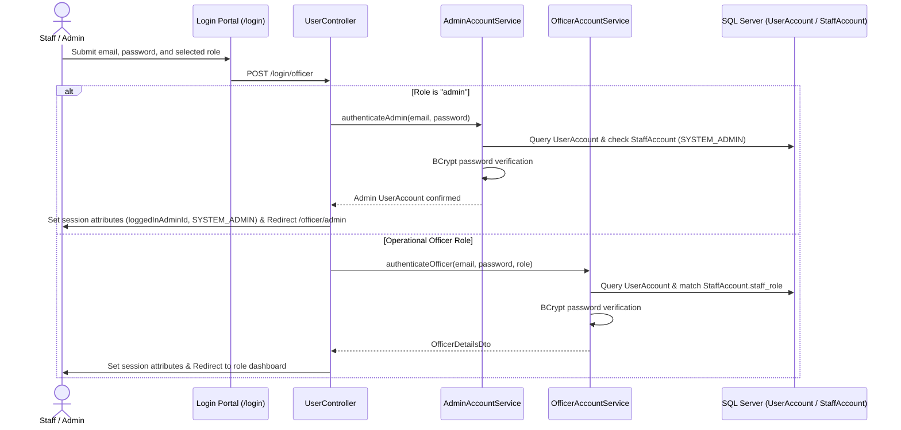

### Security Details:
- **BCrypt Encryption:** Passwords are never stored in plaintext; all user credentials use `BCryptPasswordEncoder` (strength 10).
- **Session Attributes:**
  - Citizen Session: `loggedInUserId`, `loggedInUserEmail`, `loggedInUserRole = "CITIZEN"`.
  - Officer Session: `loggedInOfficerId`, `loggedInOfficerEmail`, `loggedInOfficerRole` (`NIC_OFFICER`, `PASSPORT_OFFICER`, `CSR`, `DIRECTOR`), `loggedInOfficerEmployeeNo`, `loggedInOfficerLoginTime`.
  - Admin Session: `loggedInAdminId`, `loggedInAdminEmail`, `loggedInAdminRole = "SYSTEM_ADMIN"`.
- **Role Isolation:** If a user authenticated as a Citizen attempts to access `/officer/*`, the controller redirects to `/login`. If an officer attempts to access another officer's queue (e.g., NIC officer accessing `/officer/passport/*`), access is rejected.
- **CSRF & Action Protection:** Critical actions utilize cryptographic UUID tokens (`DeletionFormToken` and `BookingChangeRequest`) stored in the user's session.

---

# 18. VALIDATION & ERROR HANDLING

LankaID uses a defensive validation hierarchy across both client and server tiers:

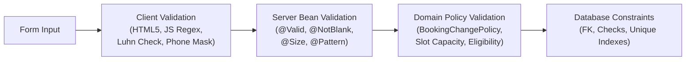

### Validation Matrix

| Validation / Error Scenario | Location | Behavior | User Impact |
| :--- | :--- | :--- | :--- |
| **Invalid Email / Phone Format** | Client & DTO (`@Pattern`) | Blocks submission; highlights form input | Descriptive error message displayed below field |
| **Password Rule Violations** | Client (`password-rules.js`) & `PasswordRules.java` | Requires >= 8 chars, 1 uppercase, 1 lowercase, 1 number, 1 symbol | Progress requirement list updates in real time |
| **Invalid Email OTP** | `UserController` & `EmailVerificationService` | Validates hash, decrements remaining attempts (max 5), checks 10-min TTL | Informs citizen of remaining attempts |
| **Invalid Walk-In SMS OTP** | `WalkInAppointmentController` & `SmsOtpService` | Validates hash, checks 180s TTL, limits resend to 60s cooldown | Shows countdown timer; prevents brute-force |
| **NIC / Passport Eligibility Conflict** | `CitizenApplicationService` | Checks `GovernmentIdentityRecord` for conflicting status | Blocks duplicate applications; redirects to renewal |
| **Appointment Reschedule < 72h**| `BookingChangePolicy.java` | Rejects change request if within 72 hours of scheduled time | Displays rejection banner: "Only bookings at least 72 hours away can be changed" |
| **Slot Over-Capacity** | `BiometricScheduleService` & DB Unique Indexes | Checks capacity count before insertion; catches concurrency collisions | Shows "Slot capacity full; please select another time" |
| **Credit Card Luhn / Expiry Error** | `CardPaymentValidation.java` | Validates Luhn checksum, 16-digit length, MM/YY future date, CVV | Highlights card field in red with corrective guidance |
| **File Upload Exceeds 10MB** | `application.properties` (`max-file-size=10MB`) | Spring MultipartFilter rejects payload | User informed: "File size exceeds allowed limit (10MB)" |

---

# 19. CRUD OPERATIONS

| Module | Create | Read | Update | Delete | Implemented Entities |
| :--- | :---: | :---: | :---: | :---: | :--- |
| **User & Staff Accounts** | ✅ | ✅ | ✅ | ✅ | `UserAccount`, `CitizenAccount`, `StaffAccount` |
| **Regional Centres** | ✅ | ✅ | ✅ | ✅ | `Centre` |
| **Applications (NIC/Passport)**| ✅ | ✅ | ✅ | ✅ | `Application`, `NICApplication`, `PassportApplication` |
| **Supporting Documents** | ✅ | ✅ | ❌ | ❌ | `ApplicationDocument` |
| **Application Reviews** | ✅ | ✅ | ❌ | ❌ | `ApplicationReview` |
| **Appointment Slots** | ✅ | ✅ | ✅ | ❌ | `BiometricAppointmentSlot`, `WalkInSlot` |
| **Appointments & Bookings** | ✅ | ✅ | ✅ | ✅ | `Appointment`, `AppointmentCheckIn` |
| **Payments** | ✅ | ✅ | ❌ | ❌ | `Payment`, `AppointmentChangePayment` |
| **Biometric Collections** | ✅ | ✅ | ❌ | ❌ | `BiometricCollection` |
| **Support Requests** | ✅ | ✅ | ✅ | ✅ | `SupportRequest` |
| **Notifications** | ✅ | ✅ | ✅ | ❌ | `Notification`, `UserNotification` |
| **Document Delivery** | ✅ | ✅ | ✅ | ❌ | `DocumentDelivery` |

### Representative CRUD Flow: Biometric Appointments

```text
[Create] ──► Citizen reserves slot ───────────► INSERT dbo.Appointment (Status: CONFIRMED)
[Read]   ◄── Citizen views pass / Officer queue ◄── SELECT dbo.Appointment JOIN dbo.Centre
[Update] ◄─► Citizen reschedules slot ─────────► UPDATE dbo.Appointment SET scheduled_at, booking_version
[Delete] ──► Citizen cancels appointment ──────► UPDATE dbo.Appointment SET appointment_status = 'CANCELLED'
```

---

# 20. MAJOR BUSINESS FLOWS

## 1. Citizen Registration with Email and SMS Verification
1. **Purpose:** Verify both citizen contact methods before account creation.
2. **User:** Citizen Applicant.
3. **Preconditions:** Valid, accessible email address and mobile number.
4. **Steps:**
   - Citizen visits `/register`, enters an email, and verifies the email OTP without leaving the page.
   - Citizen enters a mobile number and verifies the SMS OTP on the same page.
   - A green verified state is shown after each step; password fields appear only after both pass.
   - The shared OTP services enforce expiry, resend cooldowns, attempt limits, and recipient binding.
   - Upon verification, `UserAccount` and `CitizenAccount` rows are committed to the database.

## 2. First-Time NIC Application Submission
1. **Purpose:** Enable citizens to submit new national identity requests.
2. **User:** Registered Citizen.
3. **Preconditions:** Citizen must be logged in with no active NIC application.
4. **Steps:**
   - Citizen opens `/citizen/applications/nic/new`.
   - Eligibility check validates no existing NIC is registered in `GovernmentIdentityRecord`.
   - Citizen completes multi-step form (personal info, birth certificate details, permanent and postal address).
   - Form is saved as a `DRAFT` in `dbo.Application` and `dbo.NICApplication`.
   - Citizen uploads scanned birth certificate and photograph (`ApplicationDocument`).
   - Citizen reviews summary at `.../review` and clicks Submit (`current_status = 'SUBMITTED'`).

## 3. Officer Review & Decision Processing
1. **Purpose:** Audit citizen claims and document scans for compliance.
2. **User:** NIC or Passport Verification Officer.
3. **Preconditions:** Application status must be `SUBMITTED` or `UNDER_REVIEW`.
4. **Steps:**
   - Officer views queue at `/officer/nic/applications`.
   - Officer opens application; status changes to `UNDER_REVIEW`.
   - Officer inspects demographic fields and previews uploaded document scans.
   - Officer selects:
     - **Approve:** Updates status to `APPROVED`; triggers notification to citizen allowing payment.
     - **Reject:** Sets status to `REJECTED`; logs permanent rejection note in `ApplicationReview`.
     - **Request Correction:** Flags specific documents or form fields; status changes to `CORRECTION_REQUIRED`.

## 4. Payment, Biometric Booking & Pass Generation
1. **Purpose:** Collect application fees and reserve a biometric capture session.
2. **User:** Approved Citizen Applicant.
3. **Preconditions:** Application must be in `APPROVED` status.
4. **Steps:**
   - Citizen opens `/citizen/payment`, selects delivery method (Courier or Centre), and inputs card details.
   - System validates card format and records payment in `dbo.Payment`.
   - Citizen is redirected to `/citizen/appointments/biometric`.
   - Available centres and published calendar slots are loaded asynchronously.
   - Citizen selects a 30-minute window; system assigns a unique reference (`BIO-...`).
   - ZXing engine generates a QR pass containing the reference. Pass is printable and downloadable as PNG.

## 5. Physical Check-In & Biometric Collection
1. **Purpose:** Authenticate physical arrival and complete biometric capture.
2. **User:** Centre Officer.
3. **Preconditions:** Citizen arrives at scheduled centre with QR pass.
4. **Steps:**
   - Officer opens check-in workbench at `/officer/nic/biometrics`.
   - Officer scans citizen QR pass using webcam (decoded via `jsQR`) or enters reference manually.
   - System confirms validity and records `AppointmentCheckIn` with timestamp and method (`QR`).
   - Officer records fingerprint, facial photograph, and signature capture.
   - Application status updates to `BIOMETRIC_COLLECTED` (ready for printing).

## 6. Director Batch Processing & CSV Export
1. **Purpose:** Collate verified records for physical card printing and embossing.
2. **User:** Identity Service Director.
3. **Preconditions:** Applications must be in `BIOMETRIC_COLLECTED` status.
4. **Steps:**
   - Director logs in and opens `/officer/director/printing`.
   - System displays table of all ready applications across all centres.
   - Director selects applications and clicks "Process Printing Batch".
   - Application status updates to `ISSUED`; the delivery record becomes `DISPATCHED` or `READY_FOR_COLLECTION`.
   - System compiles demographic and biometric reference data into an RFC 4180-compliant CSV register.
   - Director downloads the CSV file via `/officer/director/printing/download`.

---

# 21. DESIGN PATTERNS

| Pattern | Where Used in Project | Implementation Details & Evidence | Benefit |
| :--- | :--- | :--- | :--- |
| **Model-View-Controller (MVC)** | Presentation Tier | Spring `@Controller` classes (`UserController`, `CitizenApplicationController`), Thymeleaf HTML templates, and `org.springframework.ui.Model`. | Complete separation of HTTP routing, UI rendering, and business data. |
| **Repository Pattern** | Persistence Tier | 23 interfaces extending `JpaRepository<T, ID>` (e.g., `AppointmentRepository`, `CitizenAccountRepository`). | Decouples business logic from low-level SQL/JDBC queries; enables mock testing. |
| **Service Layer Pattern** | Business Logic Tier | Domain service classes annotated with `@Service` and `@Transactional` (e.g., `CitizenApplicationService`, `PaymentService`). | Centralizes business workflows, coordinates multiple repositories, and manages transaction rollbacks. |
| **Observer Pattern** | In-app Notifications | Manual implementation: `NotificationSubject` defines registration/removal/notification, `NotificationObserver` defines `update()`, and `NotificationPublisher` owns the observer list and directly calls `InAppNotificationObserver`. | Separates notification requests from storage while preserving synchronous delivery, transaction rollback, and recipient counts. |
| **Data Transfer Object (DTO)** | Controller & Service boundaries | Form DTOs (`NewNicApplicationForm`, `OfficerRegistrationDto`, `CardPaymentForm`) and view projections (`PaymentSummary`, `VerificationReviewDetails`). | Prevents over-posting attacks, decouples DB entities from UI forms, and encapsulates validation annotations. |
| **Strategy / Policy Pattern** | Appointment Rescheduling | `BookingChangePolicy.java` defines algorithmic rules for checking if appointments can be modified (`canChange()`, `requireChangeAllowed()`). | Eliminates duplicate branching logic across controllers and services; allows rules to be tested in isolation. |
| **Adapter Pattern** | SMS Gateway | `SmsSender` interface implemented by `PhoneSmsSender` connecting to external HTTP SMS APIs. | Insulates business logic from vendor-specific SMS gateway formats; allows easy replacement with Twilio or AWS SNS. |
| **Controller Advice / Interceptor** | Cross-Cutting Concerns | `OfficerSessionIdentityAdvice.java` (`@ControllerAdvice`) injects staff session attributes; `DeletionFormToken.java` guards against CSRF/double-submit. | Eliminates boilerplate code across 21 controllers and standardizes session hydration. |
| **Singleton Pattern** | Spring IOC Container | All `@Service`, `@Repository`, and `@Component` beans are managed as singletons by Spring's application context. | Optimizes memory consumption and coordinates shared state across concurrent HTTP threads. |

### Manual Observer implementation (lecture mapping)

| Lecture role | Project class | Responsibility |
| :--- | :--- | :--- |
| Subject | `NotificationSubject` | Declares `addObserver()`, `removeObserver()`, and `notifyObservers(event)`. |
| Observer | `NotificationObserver` | Declares `update(event)`. |
| ConcreteSubject | `NotificationPublisher` | Maintains registered observers, creates notification data, and calls each observer directly. |
| ConcreteObserver | `InAppNotificationObserver` | Receives the data and calls `NotificationService` to store the notification and recipient rows. |

The observer mechanism uses ordinary Java interfaces and a `CopyOnWriteArrayList`; it does not use `ApplicationEventPublisher` or `@EventListener`. Spring still supplies dependencies and database transactions. The publisher explicitly registers its initial observers through `addObserver()` in its constructor, and duplicate registration of the same observer is ignored.

For example, application approval calls `sendToCitizen()`, which creates an `InAppNotificationEvent`, calls `notifyObservers(event)`, and receives the stored recipient count from the in-app observer. The event is passed as a method argument rather than stored as shared "latest message" state, so concurrent requests keep their notification details separate. Dispatch is synchronous; observer exceptions propagate so the surrounding workflow can roll back. If the storage observer does not handle the request, the publisher throws instead of reporting successful delivery.

---

# 22. UML / DESIGN DOCUMENTATION

## Use Case Diagram

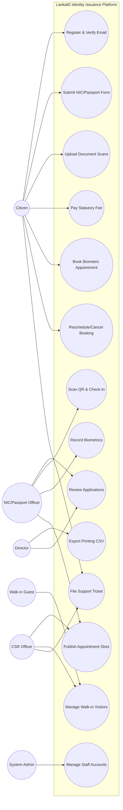

## System Class Diagram (Core Entities)

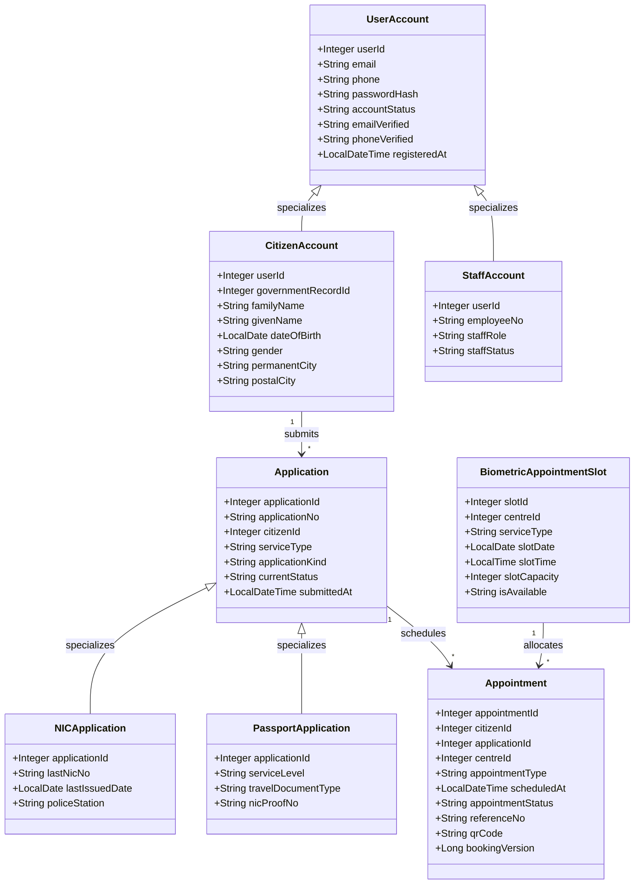

---

# 23. NON-FUNCTIONAL REQUIREMENTS

| Requirement Category | Metric / Specification | How the System Addresses It | Implementation Status |
| :--- | :--- | :--- | :--- |
| **Security: Data in Transit** | HTTPS / TLS 1.3 | Configurable SSL/TLS terminal endpoints in production profile | 🔵 Deployment Configuration |
| **Security: Password Storage** | Cryptographic Salted Hash | Passwords hashed using Spring Security `BCryptPasswordEncoder` (10 rounds) | ✅ Implemented |
| **Security: Concurrency Control**| Prevent Double Booking | `booking_version` column with optimistic locking prevents concurrent overrides | ✅ Implemented |
| **Security: Action Tokens** | CSRF / Replay Defense | Single-use UUID session tokens on destructive actions (`DeletionFormToken`) | ✅ Implemented |
| **Reliability: Connection Pool** | Zero Leak JDBC Operations | HikariCP pool with strict connection/read timeouts (5000ms) | ✅ Implemented |
| **Performance: Response Times** | Under 500ms Server Latency | Server-Side Thymeleaf rendering combined with selective DB indexing | ✅ Implemented |
| **Maintainability: Modularity** | Clean Layered Architecture | Separation of Controller, DTO, Service, Model, Repository packages | ✅ Implemented |
| **Accessibility & Usability** | Mobile Responsive UI | CSS grid/flexbox layouts, high-contrast typography, and mobile drawer | ✅ Implemented |

---

# 24. ETHICAL AND PRIVACY CONSIDERATIONS

Because LankaID processes national identity data, ethical data stewardship and strict privacy controls are fundamental design pillars:

### 1. Biometric Data Sensitivity
- **Risk:** Storing raw biometric images (fingerprints/retina scans) creates catastrophic risk of identity theft in the event of a data breach.
- **Current Mitigation:** The system **never stores raw biometric files**. Biometric collection is logged strictly as an auditable state event (`BiometricCollection`) confirming physical attendance.
- **Remaining Limitation:** Hardware-level biometric capture with PKI encryption is planned for Phase 3.

### 2. Digital Exclusion & Walk-In Fairness
- **Risk:** Citizens without internet access, smartphones, or digital literacy could be disenfranchised from obtaining national identity cards.
- **Current Mitigation:** The platform includes an anonymous public walk-in booking engine (`/walk-in`) that requires only a mobile phone number for SMS OTP verification, and empowers CSR officers to assist in-person visitors.

### 3. Separation of Reviewer Duties
- **Risk:** Officers issuing approvals without oversight could abuse authority for fraudulent document issuance.
- **Current Mitigation:** The system enforces separation of duties: application officers can review and approve, but **only the Identity Director** can export printing registers. Every review decision is permanently audited with staff IDs in `ApplicationReview`.

---

# 25. SETUP AND INSTALLATION

## Prerequisites
Ensure the following tools are installed on the host system:
1. **Java Development Kit (JDK):** Version 17 LTS or higher. Verify with:
   ```bash
   java -version
   ```
2. **Microsoft SQL Server:** 2019, 2022, or SQL Server Express running locally on port `1433`.
3. **SQL Server Management Studio (SSMS)** or **Azure Data Studio**.
4. **Git:** Version 2.x or higher.
5. **Apache Maven:** 3.8+ (or use the included `./mvnw` wrapper).

---

# 26. CLONING THE PROJECT

Clone the repository to your local workspace:

```bash
git clone https://github.com/IT25101235/LankaID.git
cd LankaID
```

---

# 27. DATABASE SETUP

1. Open **SQL Server Management Studio (SSMS)** and connect to your local SQL Server instance (`localhost`).
2. Open the query editor and run the database creation script:

```sql
USE master;
GO

IF DB_ID(N'identity_issuance_service') IS NULL
BEGIN
    CREATE DATABASE identity_issuance_service;
END;
GO
```

3. For a fresh or empty database, run [the complete current schema](database/current-database-schema.sql). It creates the database and all application tables, and stops if application tables already exist.
   - For an older schema, inspect [biometric appointment scheduling](database/biometric-appointment-scheduling.sql) and [appointment change payments](database/appointment-change-payments.sql) before applying the relevant incremental updates.
4. Verify that Hibernate DDL validation is enabled in `src/main/resources/application.properties`:
   ```properties
   spring.jpa.hibernate.ddl-auto=validate
   ```

---

# 28. ENVIRONMENT VARIABLES

The application uses local database defaults. Citizen registration requires working email and SMS delivery because both contacts must be verified. Configure the following values before demonstrating onboarding:

| Variable | Purpose | Required | Example Value |
| :--- | :--- | :---: | :--- |
| `LANKAID_MAIL_USERNAME` | Gmail account used to send 6-digit registration codes | Yes, for email OTP | `your-email@gmail.com` |
| `LANKAID_MAIL_APP_PASSWORD`| Google App Password for the sender account | Yes, for email OTP | `your-app-password` |
| `LANKAID_MAIL_FROM` | Outbound sender address displayed to citizens | No | `no-reply@lankaid.gov.lk` |
| `APP_SMS_URL` | Overrides `app.sms.url` with the full SMS gateway endpoint | Yes, if the configured endpoint is unavailable | `http://192.168.1.50:8080/sms` |
| `LANKAID_SMS_API_KEY` | Bearer authorization token for phone SMS API | Yes, for SMS OTP | `your-sms-api-key-here` |

### Setting Environment Variables in PowerShell:
```powershell
$env:LANKAID_MAIL_USERNAME="your-email@gmail.com"
$env:LANKAID_MAIL_APP_PASSWORD="your-app-password"
$env:APP_SMS_URL="http://192.168.1.50:8080/sms"
$env:LANKAID_SMS_API_KEY="secret-api-key"
```

---

# 29. BACKEND SETUP

The backend uses the included Maven wrapper. Build and compile the source:

```powershell
# On Windows PowerShell
.\mvnw.cmd clean compile

# To run tests
.\mvnw.cmd test
```

To run the application directly from the terminal:

```powershell
.\mvnw.cmd spring-boot:run
```

---

# 30. FRONTEND SETUP

Because LankaID utilizes server-side Thymeleaf rendering with native modular CSS and JavaScript assets, **no separate Node.js / npm installation or build pipeline is required**. Static assets are automatically served from `src/main/resources/static/` upon backend startup.

---

# 31. RUNNING THE COMPLETE SYSTEM

Follow this sequential startup checklist:

```text
┌─────────────────────────┐
│ 1. Start SQL Server     │ Ensure SQL Server service is running on port 1433
└───────────┬─────────────┘
            ▼
┌─────────────────────────┐
│ 2. Set Env Variables    │ Configure LANKAID_MAIL_* in terminal (optional)
└───────────┬─────────────┘
            ▼
┌─────────────────────────┐
│ 3. Start Spring Boot    │ Run .\mvnw.cmd spring-boot:run
└───────────┬─────────────┘
            ▼
┌─────────────────────────┐
│ 4. Open Web Browser     │ Navigate to http://localhost:8080
└─────────────────────────┘
```

The application will bind to port **`8080`**.

---

# 32. HOW TO USE THE SYSTEM

### Default Initial System Administrator Account:
On initial application launch, `AdminAccountInitializer` automatically provisions the primary system administrator if not present:
- **Email:** `admin@gov.lk`
- **Password:** `admin12345`
- **Role:** Select `System Administrator` on the Officer login tab.

---

### Step-by-Step Scenario Guides:

#### Scenario A: Citizen Registration & New Application
1. **Navigate:** Open `http://localhost:8080` and click **"Register as a Citizen"**.
2. **Input:** Enter an email address, Sri Lankan phone number (`07XXXXXXXX`), and password meeting security rules.
3. **Verify:** Enter the 6-digit code sent to your email.
4. **Login:** Switch to the Citizen tab at `/login` and sign in.
5. **Apply:** On the dashboard, click **"Apply for New NIC"**. Complete personal details, upload supporting document scans, review the summary, and submit.

#### Scenario B: Officer Review & Approval
1. **Sign In:** Navigate to `/login`, switch to the **"Staff / Officer Portal"** tab.
2. **Authenticate:** Enter officer credentials and choose role `NIC Application Officer`.
3. **Review Queue:** Select an application from `/officer/nic/applications`.
4. **Decision:** Inspect applicant details and document scans. Click **"Approve Application"**.

#### Scenario C: Appointment Booking & QR Check-In
1. **Pay Fee:** As the citizen, open `/citizen/payment`, input simulated card details, and submit.
2. **Schedule:** Pick an appointment centre, date, and 30-minute time slot.
3. **Pass:** View and download the QR appointment pass (`/citizen/appointments/{ref}/pass`).
4. **Check-In:** The officer opens `/officer/nic/biometrics`, scans the QR pass using the webcam, and clicks **"Complete Biometrics"**.

---

# 33. TESTING

The project incorporates extensive automated test coverage spanning unit, integration, and mock MVC test suites located in `src/test/java/lk/sliit/identityissuanceservice/`.

```powershell
# Run the complete test suite
.\mvnw.cmd test
```

### Test Suite Summary (38 Suites)

| Test Suite Class | Test Area | What Is Tested | Status |
| :--- | :--- | :--- | :---: |
| `BookingChangePolicyTests` | Domain Policy | Enforces 72-hour cutoff and status constraints | ✅ Passing |
| `BookingChangeWorkflowIntegrationTests` | Integration | End-to-end appointment rescheduling & version locking | ✅ Passing |
| `CitizenApplicationWorkflowIntegrationTests`| Integration | Full lifecycle: draft save, document upload, submission | ✅ Passing |
| `VerificationDecisionWorkflowIntegrationTests`| Integration | Officer approve, reject, and correction transitions | ✅ Passing |
| `PaymentBiometricWorkflowIntegrationTests`| Integration | Payment completion triggering biometric booking state | ✅ Passing |
| `WalkInAppointmentWorkflowIntegrationTests` | Integration | SMS OTP verification and walk-in pass generation | ✅ Passing |
| `SmsOtpServiceTests` | OTP Security | Code generation, BCrypt hashing, TTL expiry, attempt limits | ✅ Passing |
| `PhoneSmsSenderTests` | Gateway Adapter | HTTP POST payload, Bearer auth, timeout handling | ✅ Passing |
| `EmailVerificationServiceTests` | Email OTP | SMTP delivery, code matching, resend cooldowns | ✅ Passing |
| `AdminOfficerWorkflowIntegrationTests` | Integration | Admin staff provisioning, role changes, deactivation | ✅ Passing |
| `UiAndSchemaConsistencyTests` | Schema Verification | Ensures JPA entities strictly align with database tables | ✅ Passing |
| `UiRouteSmokeTests` | Web MVC Routes | Validates HTTP 200/302 responses across all controllers | ✅ Passing |

---

# 34. TROUBLESHOOTING

| Problem | Root Cause | Solution |
| :--- | :--- | :--- |
| **`Login failed for user` or connection refused on port 1433** | SQL Server service is stopped or TCP/IP protocol is disabled. | Open **SQL Server Configuration Manager**, enable TCP/IP under Network Configuration, and start the SQL Server service. |
| **`Schema-validation: missing table [dbo].[BiometricAppointmentSlot]`** | Database migration script was not executed. | Inspect and apply [biometric appointment scheduling](database/biometric-appointment-scheduling.sql) in SSMS for an older schema, or use [the full schema](database/current-database-schema.sql) for a fresh database. |
| **Registration email fails with `AuthenticationFailedException`** | Gmail App Password is not configured or normal password was used. | Create a 16-character App Password at `myaccount.google.com/apppasswords` and export `LANKAID_MAIL_APP_PASSWORD`. |
| **SMS OTP not sending for walk-ins** | Phone gateway is unreachable or IP changed. | Ensure the phone server is on the same local Wi-Fi network and update `app.sms.url` in `application.properties`. |
| **Webcam scanner does not open on officer check-in** | Browser blocked camera access or connection is not localhost/HTTPS. | Grant camera permissions in your browser settings for `http://localhost:8080`. |

---

# 35. COMMON COMMANDS

| Purpose | Command |
| :--- | :--- |
| **Clean and compile project** | `.\mvnw.cmd clean compile` |
| **Run all automated tests** | `.\mvnw.cmd test` |
| **Run specific test suite** | `.\mvnw.cmd test -Dtest=BookingChangeWorkflowIntegrationTests` |
| **Launch application server** | `.\mvnw.cmd spring-boot:run` |
| **Package runnable JAR** | `.\mvnw.cmd clean package -DskipTests` |
| **Run packaged JAR** | `java -jar target/identity-issuance-service-0.0.1-SNAPSHOT.jar` |

---

# 36. PROJECT DEVELOPMENT PROCESS

The LankaID project was engineered following an **Agile / Scrum** methodology across multiple two-week sprints:

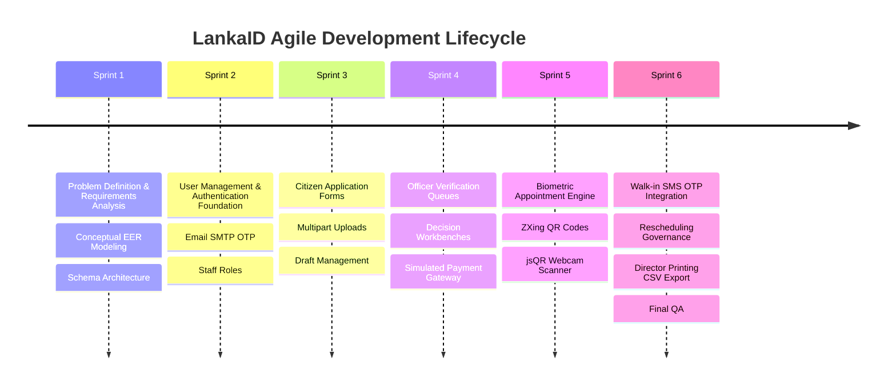

---

# 37. TEAM MEMBERS & CONTRIBUTIONS

| Team Member | Student ID / Email | Primary Role | Major Module Contributions |
| :--- | :--- | :--- | :--- |
| **Marikcar A A A** | `IT25101235`<br>`it25101235@my.sliit.lk` | Full-Stack Engineer/ Lead Architect | **User Management & Authentication**, Verification & Approval Queues (`NicVerificationController`, `PassportVerificationController`), SMS OTP Infrastructure, Payment Processing, System Integration Tests. |
| **Dharshan S** | `IT25100604`<br>`it25100604@my.sliit.lk` | Backend & Support Engineer | **Citizen Support & Walk-In Management**, Phone SMS OTP Controller (`WalkInAppointmentController`), CSR Walk-In Workbench, Support Request Ticketing, Document Handover. |
| **Weerakoon W M Y B** | `IT25100565`<br>`it25100565@my.sliit.lk` | Full-Stack Engineer / UI Architect | **Biometric & Appointment Management**, Biometric Slot Scheduling (`BiometricScheduleController`), Rescheduling Governance (`BookingChangePolicy`), System Admin Officer Management (`AdminController`), Portal Shell Theme & Styling. |
| **Jeniviya** | `IT25100689`<br>`it25100689@my.sliit.lk` | Frontend & Application Engineer | **Citizen Application Management**, New NIC & Passport Multi-Step Forms, Multipart Document Uploader, Application Tracking Timeline. |
| **Rithika** | `IT25100885`<br>`it25100885@my.sliit.lk` | Backend & Delivery Engineer | **Document Renewal, Replacement & Delivery Management**, NIC/Passport Renewal Forms, Courier Address Tracking, Collection Handovers. |

### Explore each member's assigned function

<a id="member-marikcar"></a>

<details>
<summary><strong>Marikcar A A A · IT25101235 — User management, verification and approval</strong></summary>

**Major responsibilities:** Citizen registration and login, staff authentication, NIC/passport verification queues, evidence inspection, approval, rejection, and correction requests.

**Supporting contributions:** Email/SMS OTP infrastructure, payment processing, and system integration tests.

**Workflow contribution:** Creates the account access foundation, then turns submitted requests into review decisions. Approved requests proceed to payment and appointments; corrections return to the citizen.

**Explore the implementation:** [Registration](src/main/java/lk/sliit/identityissuanceservice/User_Mgmt/Controller/CitizenRegistrationController.java) · [Login and account management](src/main/java/lk/sliit/identityissuanceservice/User_Mgmt/Controller/UserController.java) · [NIC review](src/main/java/lk/sliit/identityissuanceservice/Verification_And_Approval_Management/Controller/NicVerificationController.java) · [Passport review](src/main/java/lk/sliit/identityissuanceservice/Verification_And_Approval_Management/Controller/PassportVerificationController.java) · [Review decisions](src/main/java/lk/sliit/identityissuanceservice/Verification_And_Approval_Management/Service/VerificationReviewService.java)

**Demo focus:** Verify both contact methods, create an account, open an officer queue, and demonstrate approval or a correction request with feedback.

</details>

<a id="member-jeniviya"></a>

<details>
<summary><strong>Jeniviya · IT25100689 — Citizen application management</strong></summary>

**Major responsibilities:** First-time NIC and passport forms, draft creation and editing, supporting document uploads, submission, and application tracking.

**Workflow contribution:** Turns citizen details and evidence into a submitted request. Citizens can update flagged fields or files and resubmit after officer feedback.

**Explore the implementation:** [Application controller](src/main/java/lk/sliit/identityissuanceservice/Citizen_Application_Mgmt/Controller/CitizenApplicationController.java) · [Application service](src/main/java/lk/sliit/identityissuanceservice/Citizen_Application_Mgmt/Service/CitizenApplicationService.java) · [NIC form](src/main/resources/templates/citizen_frontends/nic_application_form.html) · [Citizen dashboard](src/main/resources/templates/citizen_frontends/citizen_dashboard.html)

**Demo focus:** Create a draft, reopen it, upload the required documents, review the summary, submit, and show the tracking view.

</details>

<a id="member-weerakoon"></a>

<details>
<summary><strong>Weerakoon W M Y B · IT25100565 — Biometric and appointment management</strong></summary>

**Major responsibilities:** Officer slot publishing, centre/date/time selection, booking capacity, QR passes, check-in, biometric completion, and booking change policies.

**Supporting contributions:** Administrator officer management and shared portal theme/styling.

**Workflow contribution:** Takes paid, approved applications through a confirmed service-centre visit and produces biometric-complete records for the director's printing queue.

**Explore the implementation:** [Slot publishing](src/main/java/lk/sliit/identityissuanceservice/Biometric_And_Appointment_Mgmt/Controller/BiometricScheduleController.java) · [Appointments and passes](src/main/java/lk/sliit/identityissuanceservice/Biometric_And_Appointment_Mgmt/Controller/AppointmentController.java) · [Biometric workbench](src/main/java/lk/sliit/identityissuanceservice/Biometric_And_Appointment_Mgmt/Controller/BiometricController.java) · [Booking change policy](src/main/java/lk/sliit/identityissuanceservice/Biometric_And_Appointment_Mgmt/Service/BookingChangePolicy.java) · [Administrator controls](src/main/java/lk/sliit/identityissuanceservice/Admin_Mgmt/Controller/AdminController.java)

**Demo focus:** Publish an available slot, book it after payment, download the QR pass, scan or enter its reference, and complete simulated biometrics.

</details>

<a id="member-rithika"></a>

<details>
<summary><strong>Rithika · IT25100885 — Document renewal, replacement and delivery</strong></summary>

**Major responsibilities:** NIC/passport renewal and lost replacement requests, home delivery selection, collection centre selection, delivery tracking, and document handover.

**Workflow contribution:** Brings existing-document requests into the review pipeline and manages the final delivery or collection stage after issuance.

**Explore the implementation:** [Renewal/replacement controller](src/main/java/lk/sliit/identityissuanceservice/Document_Renewal_Replacement_And_Delivery_Mgmt/Controller/DocumentRenewalReplacementController.java) · [Renewal/replacement service](src/main/java/lk/sliit/identityissuanceservice/Document_Renewal_Replacement_And_Delivery_Mgmt/Service/DocumentRenewalReplacementService.java) · [Delivery controller](src/main/java/lk/sliit/identityissuanceservice/Document_Renewal_Replacement_And_Delivery_Mgmt/Controller/DocumentDeliveryController.java) · [Delivery and handover service](src/main/java/lk/sliit/identityissuanceservice/Document_Renewal_Replacement_And_Delivery_Mgmt/Service/DocumentDeliveryService.java)

**Demo focus:** Create an eligible renewal/replacement request, select a delivery method, and demonstrate receipt confirmation or CSR collection handover after printing.

</details>

<a id="member-dharshan"></a>

<details>
<summary><strong>Dharshan S · IT25100604 — Citizen support and service management</strong></summary>

**Major responsibilities:** Guest walk-in booking, phone OTP verification for walk-ins, CSR schedules and check-in, support request submission, CSR responses, and document handover assistance.

**Workflow contribution:** Gives visitors an assisted service route and helps citizens resolve questions throughout the application journey. CSR handover connects the support workbench to the delivery module.

**Explore the implementation:** [Walk-in controller](src/main/java/lk/sliit/identityissuanceservice/Citizen_Support_And_Service_Mgmt/Controller/WalkInAppointmentController.java) · [Walk-in booking service](src/main/java/lk/sliit/identityissuanceservice/Citizen_Support_And_Service_Mgmt/Service/WalkInAppointmentService.java) · [Support controller](src/main/java/lk/sliit/identityissuanceservice/Citizen_Support_And_Service_Mgmt/Controller/CitizenSupportController.java) · [Support service](src/main/java/lk/sliit/identityissuanceservice/Citizen_Support_And_Service_Mgmt/Service/CitizenSupportService.java)

**Demo focus:** Verify a guest phone, book and pay for a walk-in slot, present the pass, complete CSR assistance, and respond to a citizen support request.

</details>

**Shared system handoff:** Notifications connect events across modules. The director's [printing service](src/main/java/lk/sliit/identityissuanceservice/Admin_Mgmt/Service/PrintingExportService.java) consumes biometric-complete applications and updates the delivery module after issuance. The contribution record does not name a primary owner for director printing, so it is shown as an administration function in the workflow.

[Back to assignment map ↑](#member-assignments) · [Follow the workflow](#system-workflow)

---

# 38. PROJECT REQUIREMENTS TRACEABILITY

| Specification Requirement | Target Module | Implementation Evidence | Status |
| :--- | :--- | :--- | :---: |
| **Online Citizen Registration** | `User_Mgmt` | `UserController.java`, `EmailVerificationService.java` | ✅ Complete |
| **First-time NIC & Passport Applications** | `Citizen_Application_Mgmt` | `CitizenApplicationController.java`, multi-step forms | ✅ Complete |
| **Renewal & Lost Document Workflows** | `Document_Renewal_Replacement...` | `DocumentRenewalReplacementController.java` | ✅ Complete |
| **Document Scanning & Uploads** | `Citizen_Application_Mgmt` | `ApplicationDocumentRepository`, disk persistence | ✅ Complete |
| **Officer Auditing & Decisions** | `Verification_And_Approval...` | `NicVerificationController.java`, `ApplicationReview` | ✅ Complete |
| **Capacity-Managed Appointment Booking**| `Biometric_And_Appointment...`| `BiometricScheduleService.java`, slot calendars | ✅ Complete |
| **QR Code Contactless Check-In** | `Biometric_And_Appointment...`| ZXing pass generator & `jsQR` webcam scanner | ✅ Complete |
| **Payment Settlement** | `Payment_Mgmt` | `PaymentController.java`, Luhn card validation | ⚠️ Simulated Gateway |
| **Biometric Capture Audit** | `Biometric_And_Appointment...`| `BiometricController.java`, capture state logging | ⚠️ Simulated Hardware |
| **Director Production Export** | `Admin_Mgmt` | `PrintingExportService.java`, CSV streaming | ✅ Complete |

---

# 39. LIMITATIONS

1. **Simulated Payment Gateway:** Card transactions undergo strict client/server validation, but connect to a simulated processor rather than a live commercial banking IPG.
2. **Simulated Hardware Biometrics:** Biometric capture records audit events in the database, but does not interface with physical fingerprint/retina scanner drivers.
3. **Single-Response Support Tickets:** Citizen inquiries currently support single responses from CSRs rather than real-time multi-message threaded conversations.
4. **Local Disk Document Storage:** Uploaded scans reside on the local server filesystem (`uploads/`) rather than an encrypted cloud object store (AWS S3).

---

# 40. FUTURE ENHANCEMENTS

### Short-Term
- Integrate Flyway for automated database migration execution.
- Implement threaded CSR messaging with multi-attachment support.
- Deploy full Spring Security filter chain with automated CSRF protection tokens across all GET/POST requests.

### Medium-Term
- Connect live payment gateways (e.g., PayHere or Commercial Bank IPG).
- Migrate document attachments to encrypted Amazon S3 buckets with expiring pre-signed download URLs.
- Integrate automated optical character recognition (OCR) to pre-fill application data from scanned birth certificates.

### Long-Term
- Interface with certified ICAO-compliant passport biometric hardware capture devices.
- Deliver native iOS and Android mobile citizen companion apps with digital wallet QR credentials.

---

# 41. PROJECT STATUS

**Current Overall Completion:** **Approximately 82%** (Enterprise Functional Prototype)

| Functional Area | Status | Evidence / Notes |
| :--- | :---: | :--- |
| **User Onboarding & Auth** | 95% | Email OTP, BCrypt, session governance complete |
| **Citizen Application Forms**| 90% | First-time, renewal, replacement, draft edit complete |
| **Verification Queues** | 95% | Separate queues, review inspection, decisions complete |
| **Biometric Scheduling** | 90% | Slot publishing, booking, QR passes, 72h rule complete |
| **Walk-In & Phone SMS OTP** | 85% | Live SMS OTP, CSR counter workbench complete |
| **Payment Processing** | 80% | Luhn validation, receipts, simulated gateway |
| **Director Printing Export** | 85% | CSV batch download and state transition complete |
| **Automated Testing** | 85% | 38 unit and integration test suites passing |

---

# 42. SCREENSHOTS / VISUAL GUIDE

Use the links below to inspect the actual view templates. Live screens require the application, database, and role-specific accounts to be running locally.

| Screen / View | Primary Purpose | File Location |
| :--- | :--- | :--- |
| **Landing Portal** | Overview of services and direct access to login/register | [Landing template](src/main/resources/templates/index.html) |
| **Citizen Dashboard** | Central citizen portal with status tracking & active alerts | [Dashboard template](src/main/resources/templates/citizen_frontends/citizen_dashboard.html) |
| **New Application Form**| Structured multi-tab form with client validation | [NIC form template](src/main/resources/templates/citizen_frontends/nic_application_form.html) |
| **Biometric QR Pass** | High-contrast appointment pass with scannable QR code | [QR pass template](src/main/resources/templates/citizen_frontends/biometric_appointment_pass.html) |
| **Officer Review Desk** | Side-by-side demographic and document audit view | [Review template](src/main/resources/templates/officers_frontends/application_review.html) |
| **Biometric Calendar** | Visual schedule showing daily capacity and slots | [Schedule template](src/main/resources/templates/officers_frontends/biometric_schedule.html) |
| **Director Dashboard** | National throughput charts and CSV export triggers | [Director template](src/main/resources/templates/officers_frontends/director_dashboard.html) |

<a id="demo-checklist"></a>

## Guided system demo

Prepare a local database, working email/SMS delivery, an available service centre, and the required staff accounts. Use sample citizen data and documents. Each expandable checklist follows a member's major function; the director stage completes the shared pipeline.

<details>
<summary><strong>1 · Account access and applications — Marikcar, Jeniviya, Rithika</strong></summary>

- [ ] Open the registration page and verify email and phone OTPs.
- [ ] Create a citizen account and log in.
- [ ] Choose a first-time NIC/passport request, or an eligible renewal/replacement request with verified existing identity.
- [ ] Save and reopen a draft, upload the required evidence, and submit.
- [ ] Show the application reference and current status on the citizen portal.

</details>

<details>
<summary><strong>2 · Review decisions and payment — Marikcar</strong></summary>

- [ ] Log in as the matching NIC/passport officer and open the submitted request.
- [ ] Inspect applicant details and document previews.
- [ ] Request a correction, then show citizen correction and resubmission.
- [ ] Approve the request and show the citizen notification.
- [ ] Choose home delivery or centre collection and complete simulated payment.

</details>

<details>
<summary><strong>3 · Appointment and biometric visit — Weerakoon</strong></summary>

- [ ] Publish an available future slot from the officer schedule.
- [ ] Book that slot from the paid citizen application.
- [ ] Download or print the QR appointment pass.
- [ ] Check in from the officer workbench using QR scanning or manual reference input.
- [ ] Complete simulated biometric capture and show `BIOMETRIC_COLLECTED`.

</details>

<details>
<summary><strong>4 · Issuance and delivery — Director function, Rithika, Dharshan</strong></summary>

- [ ] Open the director printing queue and select the biometric-complete application.
- [ ] Process the batch and download the CSV register.
- [ ] Show application status `ISSUED` and the delivery tracking reference.
- [ ] For home delivery, confirm receipt; for centre collection, have the CSR record handover.
- [ ] Show delivery status `DELIVERED` or `COLLECTED`.

</details>

<details>
<summary><strong>5 · Walk-in assistance and support — Dharshan</strong></summary>

- [ ] Publish a CSR walk-in slot and open the guest walk-in portal.
- [ ] Verify the guest phone, select a slot, complete simulated payment, and show the pass.
- [ ] Check in the visitor and complete assistance from the CSR workbench.
- [ ] Submit a citizen support request and show the CSR response.

</details>

The checklists are presentation guides; checkboxes in a README are static Markdown and do not save demo progress.

[Back to visual guide ↑](#explore-lankaid)

---

# 43. VISUAL DIAGRAM COLLECTION

### Complete Request-Response Lifecycle

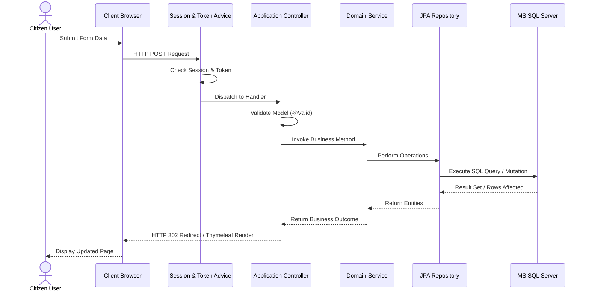

---

# 44. QUICK START

```powershell
# 1. Clone repository
git clone https://github.com/IT25101235/LankaID.git
cd LankaID

# 2. Create the schema in SSMS using a fresh/empty database
# Run database/current-database-schema.sql
# See section 28 for email/SMS configuration before registration

# 3. Compile and launch application
.\mvnw.cmd spring-boot:run

# 4. Open application in browser
# http://localhost:8080
```

---

# 45. API QUICK REFERENCE

| Module | Method | Endpoint | Primary Purpose |
| :--- | :---: | :--- | :--- |
| **Auth** | `POST` | `/login` | Authenticate citizen user |
| **Auth** | `POST` | `/login/officer` | Authenticate staff/director/admin |
| **Auth** | `POST` | `/register` | Register citizen with email verification |
| **Applications** | `POST` | `/citizen/applications/nic/new` | Create/edit new NIC application draft |
| **Applications** | `POST` | `/citizen/applications/passport/new` | Create/edit new Passport draft |
| **Documents** | `POST` | `/citizen/applications/{svc}/documents`| Upload supporting document scan |
| **Verification** | `POST` | `/officer/nic/applications/{ref}/approve`| Approve NIC application |
| **Verification** | `POST` | `/officer/passport/applications/{ref}/approve`| Approve Passport application |
| **Payment** | `POST` | `/citizen/payment` | Process statutory application fee |
| **Appointments** | `POST` | `/citizen/appointments/biometric/book` | Reserve biometric appointment slot |
| **Appointments** | `POST` | `/citizen/appointments/{ref}/manage/cancel`| Cancel appointment booking |
| **Biometrics** | `POST` | `/officer/{svc}/biometrics/check-in` | Check in citizen via QR code |
| **Director** | `GET` | `/officer/director/printing/download`| Download printed CSV register |
| **Admin** | `POST` | `/officer/admin/officers` | Provision new staff account |

---

# 46. GLOSSARY

| Term | Definition |
| :--- | :--- |
| **NIC** | National Identity Card issued to Sri Lankan citizens by the Department of Registration of Persons. |
| **Biometric Collection** | Physical recording of applicant fingerprints, digital facial portrait, and electronic signature. |
| **jsQR** | High-performance JavaScript library that inspects raw video frames from webcams to decode QR barcodes. |
| **ZXing** | "Zebra Crossing" multi-format 1D/2D barcode image processing library implemented in Java. |
| **Luhn Algorithm** | Formula used to validate credit card numbers against accidental errors. |
| **BCrypt** | Adaptive, cryptographic password-hashing function designed to defend against rainbow table attacks. |
| **CSR** | Citizen Service Representative responsible for walk-ins, complaints, and manual identity handovers. |

---

# 47. REFERENCES

1. Department of Registration of Persons Sri Lanka, "Guidelines for Issuance of National Identity Cards," Official Gazette, 2023.
2. Spring Boot Documentation Team, "Spring Boot Reference Guide (v3.x / 4.x)," VMware Tanzu, 2024. [Online]. Available: https://docs.spring.io/spring-boot/
3. R. Johnson et al., *Spring Framework Reference Documentation*, Pivotal Software, 2024.
4. Microsoft Corp., "Microsoft SQL Server 2019 Technical Documentation," Microsoft Docs, 2023.
5. C. J. Date, *An Introduction to Database Systems*, 8th ed. Boston, MA: Addison-Wesley, 2004.
6. IEEE Standards Association, "IEEE Standard for Software and System Test Documentation," *IEEE Std 829-2008*, 2008.

---

# 48. LICENSE

This project was created as an academic group submission for **SE2030 (Software Engineering)** at the **Sri Lanka Institute of Information Technology (SLIIT)**.  
*License information is not currently specified in the repository. All rights reserved by the development team and SLIIT.*

---

# 49. CONTRIBUTING

### Team Branching & Pull Request Workflow:
1. **Clone & Branch:** Create a feature branch from `main`:
   ```bash
   git checkout -b feature/your-feature-name
   ```
2. **Implement & Test:** Make code modifications and ensure all tests pass:
   ```bash
   .\mvnw.cmd test
   ```
3. **Commit Cleanly:** Format commit messages descriptively:
   ```bash
   git commit -m "feat(appointment): add capacity limit verification"
   ```
4. **Push & PR:** Push the feature branch to GitHub and open a Pull Request for review:
   ```bash
   git push origin feature/your-feature-name
   ```

---

# 50. FINAL PROJECT MAP

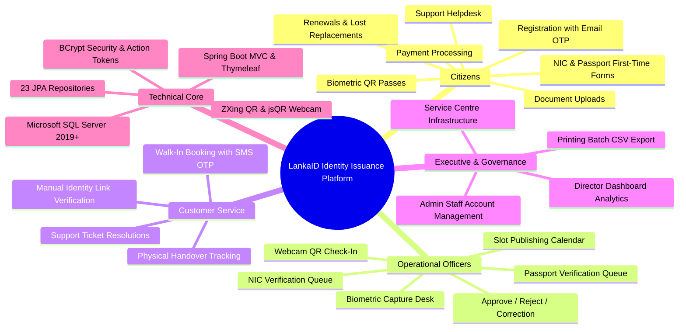
